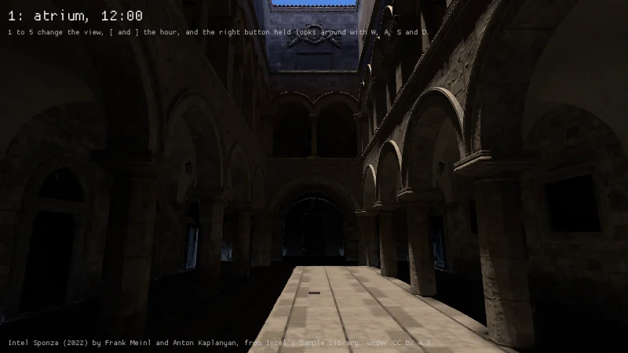
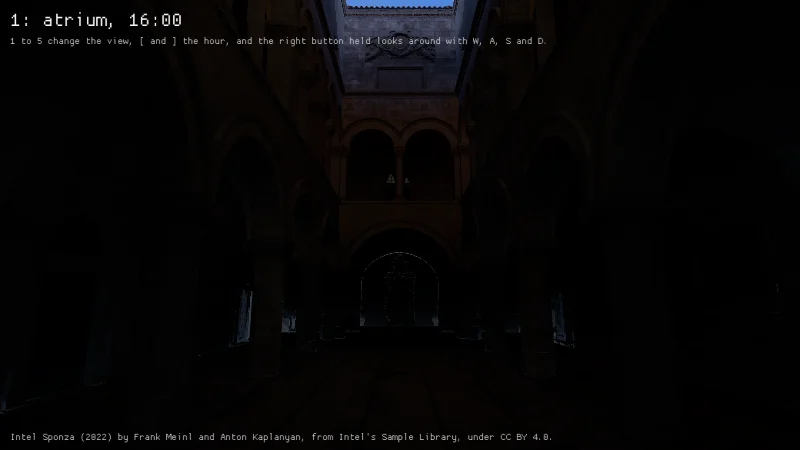
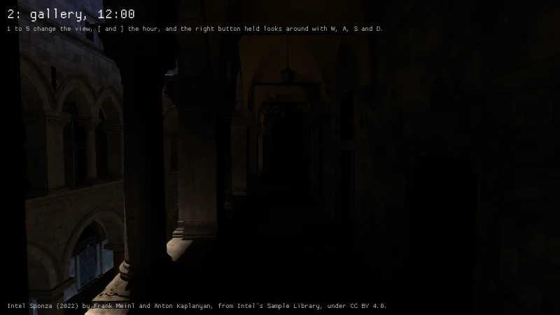
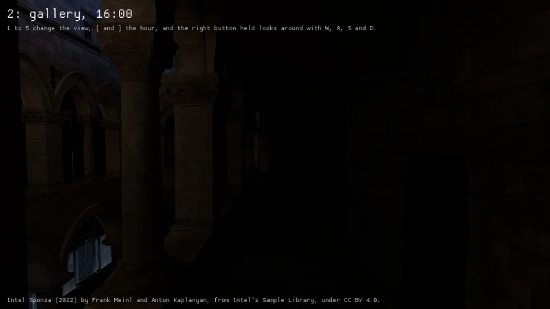
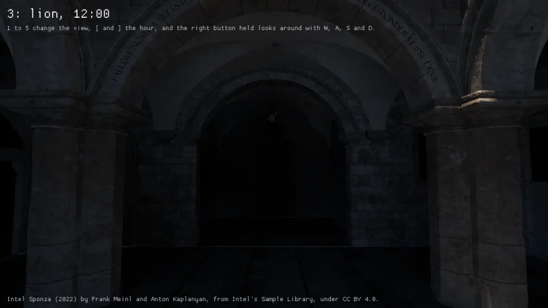
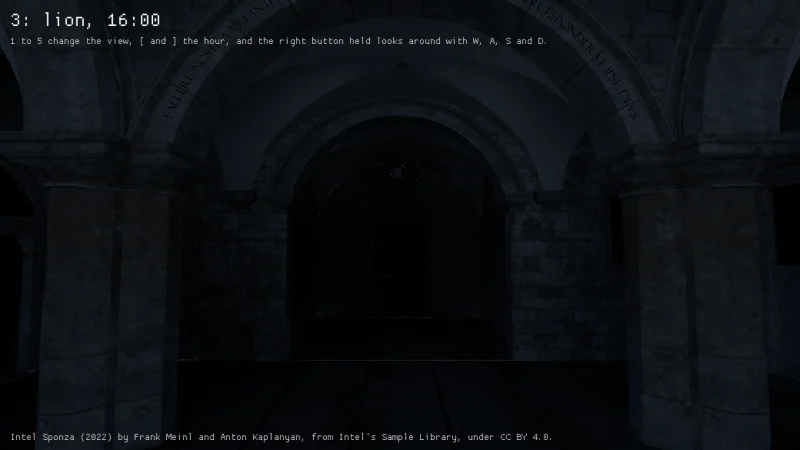
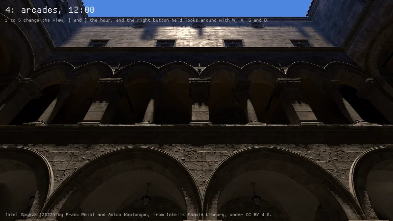
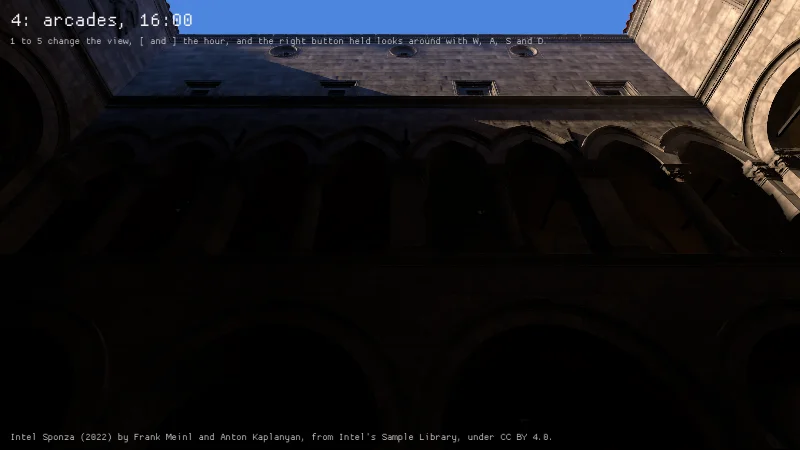
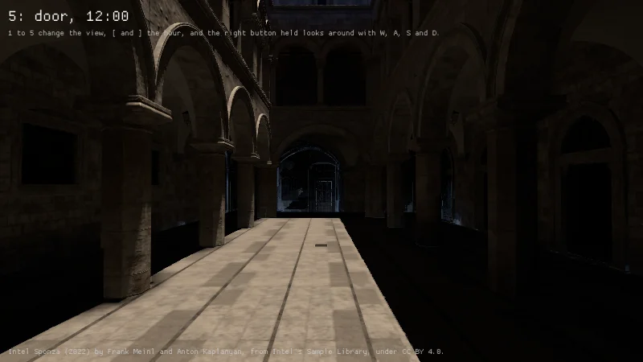
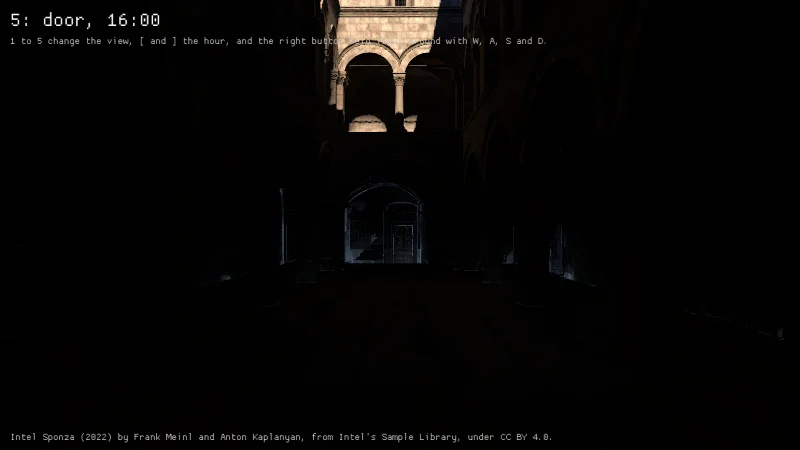

Intel's Sponza in `scenes_sponza`, driven by `build/drive-sponza.sh` through its five named views at
noon and at 16:00, at 800 by 450 at High on an RTX 4070 Laptop GPU with driver 615.78.08 under
tuned's `powersave-bazzite`, each view held 90 frames before its capture. The pack is the one
`scenes/intel-sponza.json` names, unpacked from a copy made here by `build/make-scene-pack.py` with
the manifest's SHA-256, since the release it names holds no asset yet.

| View | Noon | 16:00 |
|---|---|---|
| The atrium from the main door's end |  |  |
| The upper gallery |  |  |
| The lion's end |  |  |
| The arcades from the atrium's floor |  |  |
| The main door from the lion's end |  |  |

A frame took 40 to 57 ms, the atrium's first 85 with the frame that builds the field in it, of
which the shadow map's cascades took 31 on the GPU, drawing the scene's 3.75 million triangles into
each, the scene's pass 13 and the window's depth 7.5. The pack holds the building alone, with none
of Intel's curtains, which are a pack of their own, so the arcades take their view.

Two faults showed on the way. A BC5 normal map, which holds x and y alone, sampled its blue as 0,
so the model pass read every normal turned into its surface, and the atrium's floor took 15 of 255
from a sun with no shadows where it takes 153 with z worked out from x and y. And at the field's
default budget its 256 meshes waiting for their build stood in it as their boxes for 330 frames,
the box of the outer walls filling the building and shading the sun from all of it, so the example
builds every cascade a view moves into in the frame of the jump.

On lavapipe a frame of it took 40 s, so the pack run drives it on the macOS runner's GPU.
