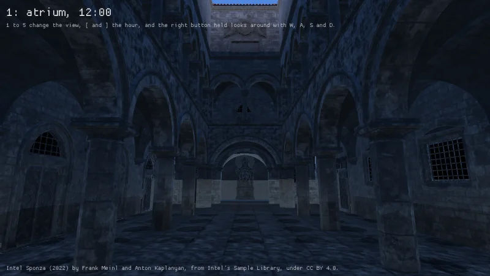
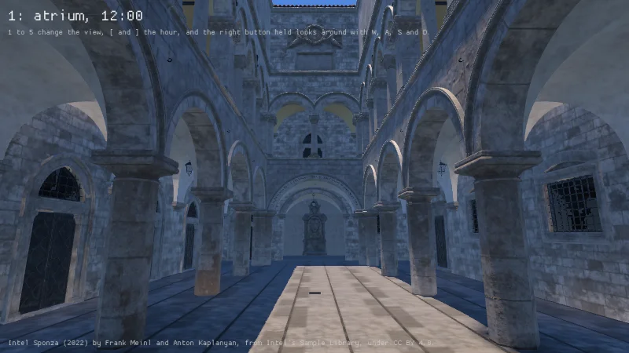

A mesh that came and has not moved stands in for nothing in the scene's field until it is built,
where it was stamped as its box meanwhile. Read on the engine's tree against `4df9309c` in Debug,
the voxel game in Release, on an RTX 4070 Laptop GPU with driver 615.78.08 under tuned's
`powersave-bazzite`, each before and after with the one file changed.

Intel's Sponza in `scenes_sponza` at the atrium view at noon at 800 by 450, the field at its default
budget of 32,768 triangles a frame, from a fresh start, the floor read in the sun and in the shade.

| Frame | Stamped before | Sun before | Shade before | Stamped after | Sun after | Shade after |
|---|---|---|---|---|---|---|
| 28 | 256 | 29, 39, 54 | 29, 39, 54 | 0 | 163, 149, 141 | 40, 56, 81 |
| 120 | 256 | 29, 39, 54 | 29, 39, 54 | 0 | 161, 144, 126 | 25, 28, 35 |
| 309 | 256 | 29, 39, 54 | 29, 39, 54 | 0 | 160, 143, 123 | 17, 17, 18 |
| 356 | 0 | 160, 143, 123 | 13, 12, 11 | 0 | 160, 143, 123 | 13, 12, 11 |

| Before, frame 70 | After, frame 72 |
|---|---|
|  |  |

Before, the box of the outer walls filled the building and the sun's contact shadows darkened every
room until the 3.75 million triangles were built. After, the floor in the sun reads its own from the
first frames, and the floor in the shade takes the sky's light through what is not yet built until
then.

The bounce rooms' nine views at 800 by 450, each read whole after 120 frames, are the same at High
and at Low before and after, the first frame of view 1 102, 93 and 71 where 115, 104 and 75. The
voxel game's cherry grove at seed 1 at High at 1280 by 720, its shading off, reads 157, 145 and 152
whole and 98, 99 and 20 on its floor once settled, before and after alike; in the frames after the
teleport 25 to 37 of its meshes were stamped where 203 to 256 were, into 290 to 1,477 bricks where
9,227 to 11,945, and the frame read its settled light 20 frames after it where 40.

