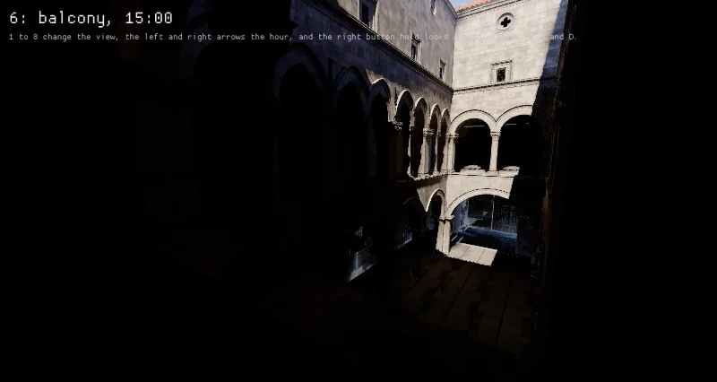
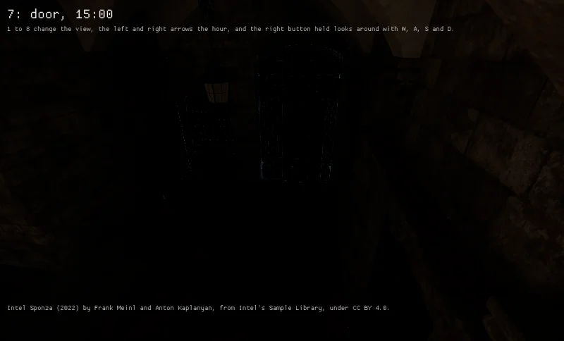
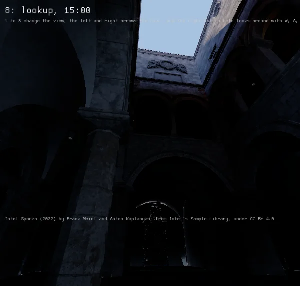

Intel's Sponza in `scenes_sponza` from its sixth, seventh and eighth views, each placed by eye where
a picture of the scene drawn in Unity's HDRP was taken, at 15:00 at High on an RTX 4070 Laptop GPU
with driver 615.78.08 under tuned's `powersave-bazzite`, with AgX's curve and an exposure of 3,
which puts the day sky's noon sun, 1.08 in its units, where a camera at 14.6 EV puts a sun of 97,050
lux, each drawn at its picture's shape.

| The first floor's gallery | The main door under the vault | Up from the atrium's floor |
|---|---|---|
|  |  |  |

The pictures were drawn with HTrace's world space global illumination over adaptive probe volumes,
a sun of 97,050 lux, a physically based sky and a camera at about 14.6 EV under AgX, and the dump of
2026-10-31 holds them beside these and no commit does. The views' frames have means of 19, 17 and
16 of 255 where the pictures' are 73, 67 and 64, 5, 4 and 2 where 57, 50 and 43, and 15, 18 and 22
where 82, 75 and 71. The stone the sun lights reads near the pictures', and the stone in shade near
black where theirs reads the light from the walls and floors around it. The door's corner differs
in the model, its door barred with iron and its vestibule narrower, and the look up takes a field
of 84 degrees whose edges a camera of straight lines stretches, where the picture's seem drawn
with a Panini projection. A black box outside the main door keeps the sky out of the gap around
it, as the scene the pictures come from holds one.
