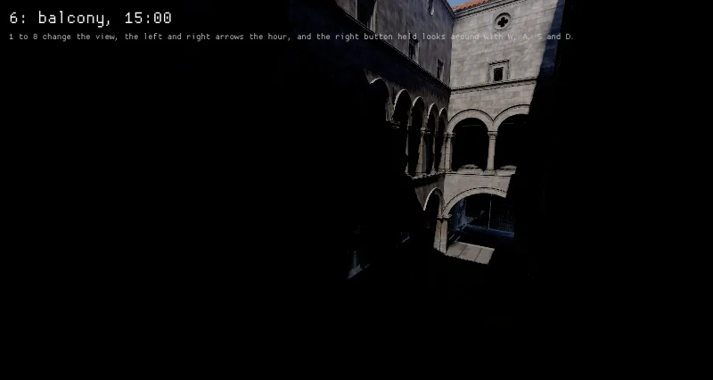
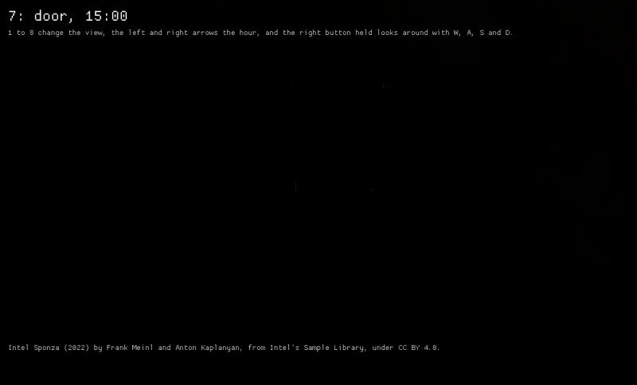
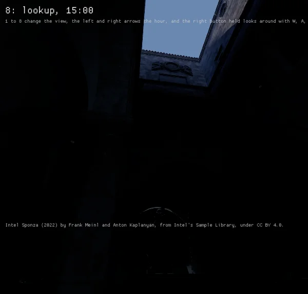

Intel's Sponza in `scenes_sponza` in physical units at the values of the scene its last three
views are matched against, a sun of 97,050 lux at 5,633 K, a clear sky of 20,000 lux on a level
floor and a camera at ISO 200, 1/200 s and f/16, EV 14.64, under AgX's curve, at 15:00 at High on
an RTX 4070 Laptop GPU under tuned's `powersave-bazzite`, each view at its picture's shape.

| The first floor's gallery | The main door under the vault | Up from the atrium's floor |
|---|---|---|
|  |  |  |

Through that camera a white surface facing the sun reads 1.006 before the curve. The frames' means
read 9, 9 and 9 of 255 where the pictures' read 73, 67 and 64, 1, 1 and 1 where 57, 50 and 43, and
7, 9 and 11 where 82, 75 and 71, and their brightest hundredth 145 where 228 from the gallery and
132 where 234 looking up. The stone the sun lights reads near the pictures', a little darker, and
the stone in shade near black, where the pictures' reads a mid gray, so the light reaching the
shade, from the sky through the arcades and off the sunlit stone, falls far short of theirs, which
global illumination is read against next. With auto exposure held between EV 4 and 14, as the
camera of the pictures' scene allows, the means read 89, 120 and 110 to 127, the shade showing and
the sunlit atrium white.
