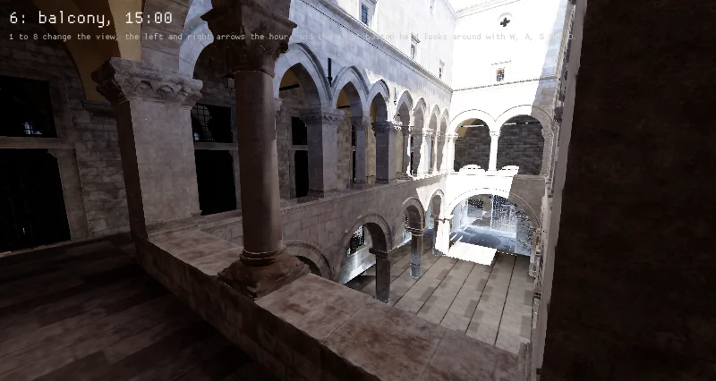
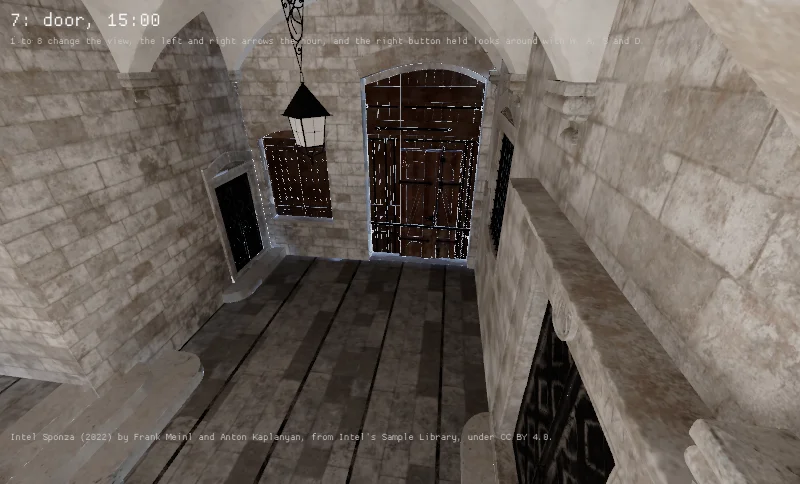
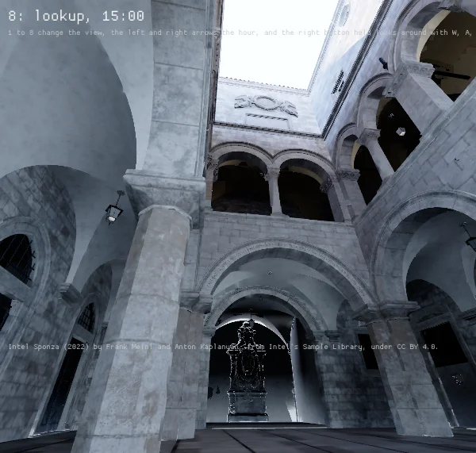

Intel's Sponza in `scenes_sponza` at its three matched views at 15:00 at High, in the physical units
of item 154, metered view by view as the camera of the scene they are matched against meters, its
automatic mode between EV 4 and 14, center-weighted (`SetAutoExposureMetering`), brought 0.79 stops
under a mid gray as a reflected light meter brings what it reads, which `sponza.metered on` sets.

| The first floor's gallery | The main door under the vault | Up from the atrium's floor |
|---|---|---|
|  |  |  |

The frames' means read 74, 66 and 65 of 255 where the pictures' read 73, 67 and 64, 107, 98 and 91
where 57, 50 and 43, and 94, 102 and 112 where 82, 75 and 71. Metered over the whole picture they
read 80, 99 and 92 in red, and with no compensation 91, 130 and 115. The gallery's view meets its
picture, and the door's stays a stop or so brighter than its picture's, whose camera brings it less
far toward a mid gray than the meter's mean does. The fixed camera's frames are item 154's.
