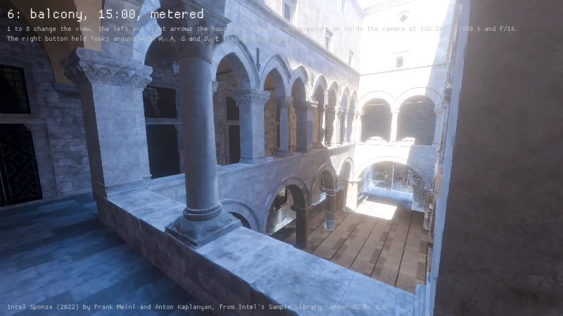
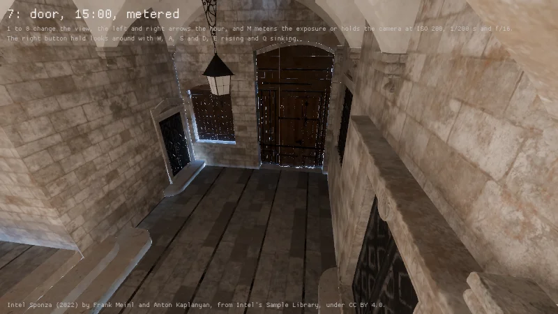
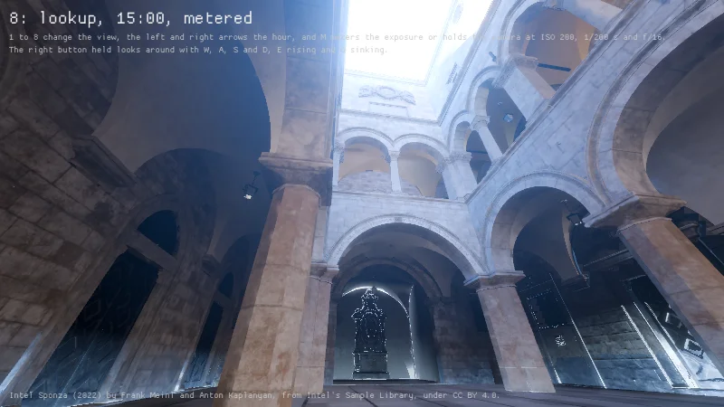
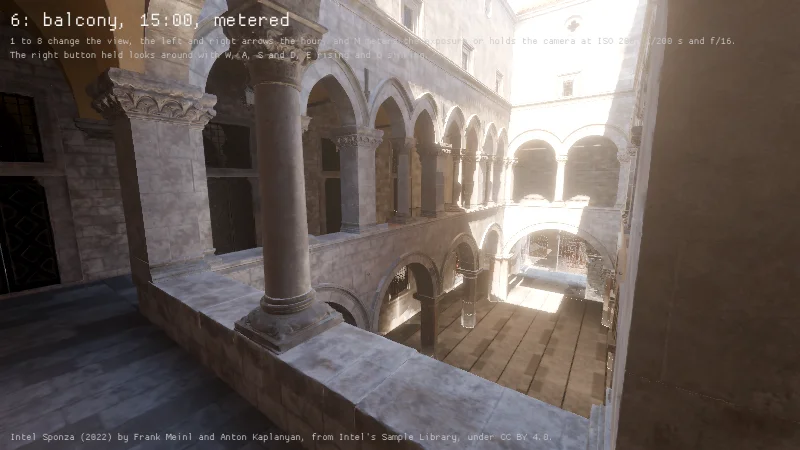
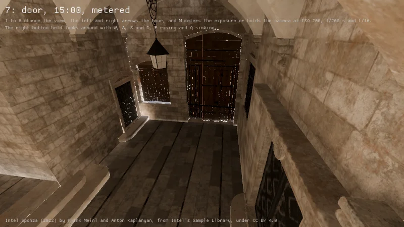
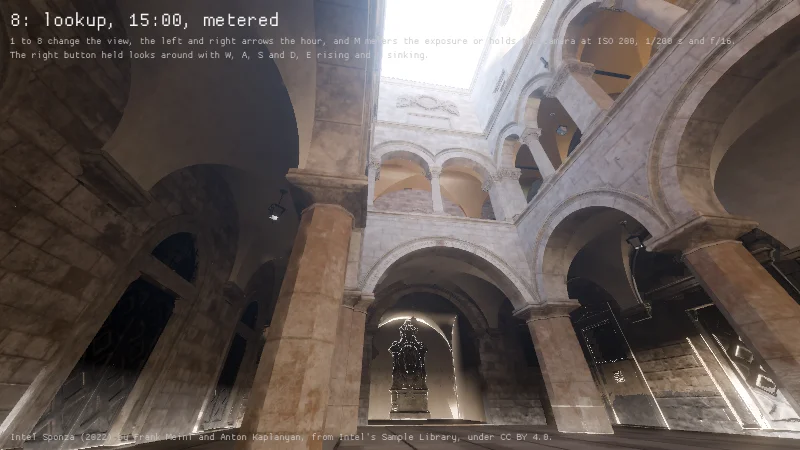

The sun and the sky through the air of the scene the Sponza views are matched against, HDRP's
Earth with its aerosols spread over 12 km and a white ground, its sun set outside the air to
120,000 lux times the sine of its height at 5,633 K, at that scene's heights for three hours (the
Sky module's `Sun` and `SkyLight`, and for HDRP its own transmittance worked out by its formula).

| Hour | Height | Sun at the ground here | HDRP's | Sky on a level floor here |
|---|---|---|---|---|
| 8:00 | 16.55° | 22,580 lux at 4,062 K | 19,910 lux at 4,055 K | 2,060 lux |
| 12:00 | 51.40° | 80,190 lux at 4,903 K | 71,030 lux at 4,903 K | 10,770 lux |
| 15:05 | 53.97° | 83,410 lux at 4,924 K | 73,890 lux at 4,924 K | 11,410 lux |

HDRP's lux are on the assumption, which no reading of the scene itself has settled, that Unity's
color of a temperature has its brightest channel at 1, where the engine's has a luminance of 1. The
example's own sun path leans 6 degrees and stands 44.7 degrees high at 15:00 where the scene's
stands 54. Metered at 15:00, the balcony's, the door's and the view up's red over blue read 0.67,
1.81 and 0.62 before the air and 1.24, 2.84 and 1.31 through it, where the scene's pictures read
1.13, 1.60 and 1.15.

| The first floor's gallery | The main door under the vault | Up from the atrium's floor |
|---|---|---|
|  |  |  |
|  |  |  |
