# 3DEngine devlog

What landed in 3DEngine, by day and newest first, with the pictures taken on the way, the captures
the repository keeps under `.github/assets` and the pictures made while an item was built, kept
under `.github/assets/readings` as WebP files named by their day, each on the day its name says, and
the notes written beside them as Markdown files named the same way. A line under Done names the item
of .github/REVIEW.md or .github/REVIEW-ARCHIVE.md and the commit that closed it.

## 2026-10-26

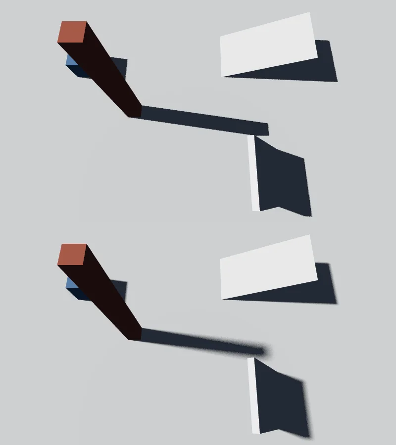
A pole, a block and two slabs on a floor under a sun 45 degrees up, seen from above, above with the
sun given no width, every edge as sharp, and below with it 3 degrees across, the shadows sharp where
each caster meets the floor and soft where they fall far from it.

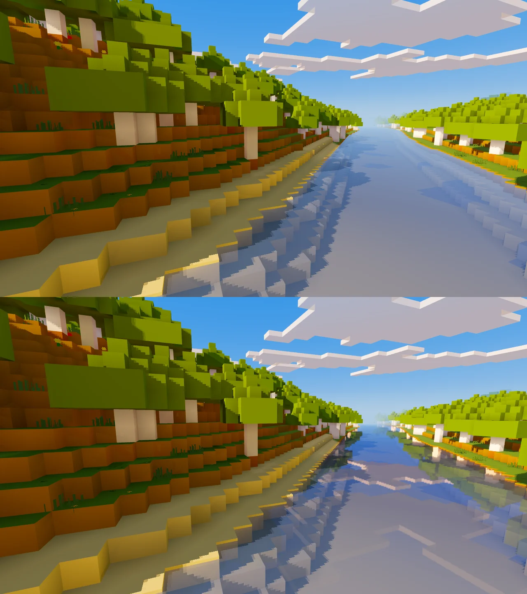
The voxel game's river in its cherry grove at seed 1 at Low at 1280 by 720, seen along it from four
blocks over the water, above with no plane set, the water showing the sky its fresnel term gives,
and below with the plane at the water's top, the water's shader in a copy of the game laying
`mirrored` over that sky, the far bank's trees, trunks and sand mirrored in it.

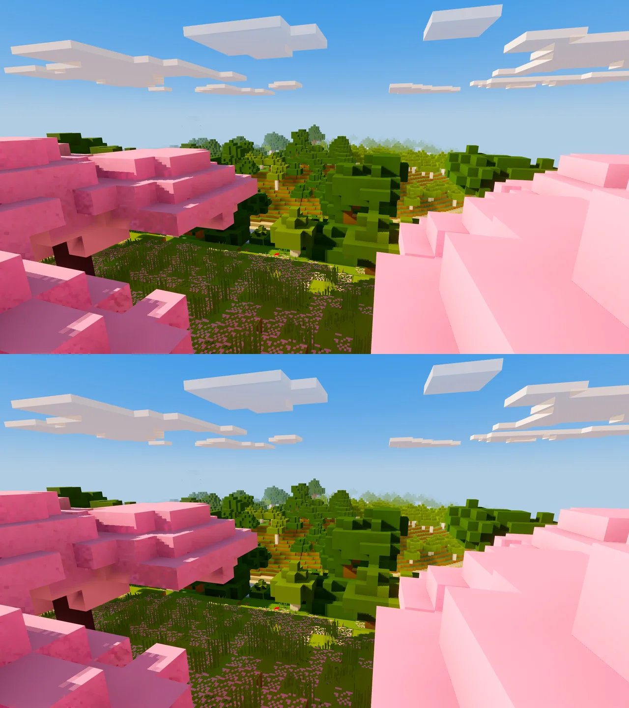
The voxel game's cherry grove at seed 1 at High at 1920 by 1080, scaled to 1280 by 720, its leaves
letting half the light through a unit, above with each leaf a ray crosses shaded where it crossed
it, global illumination 5.93 to 6.23 ms, and below with the first leaf shaded for all of them, 5.25
to 5.42, the two alike to the eye.

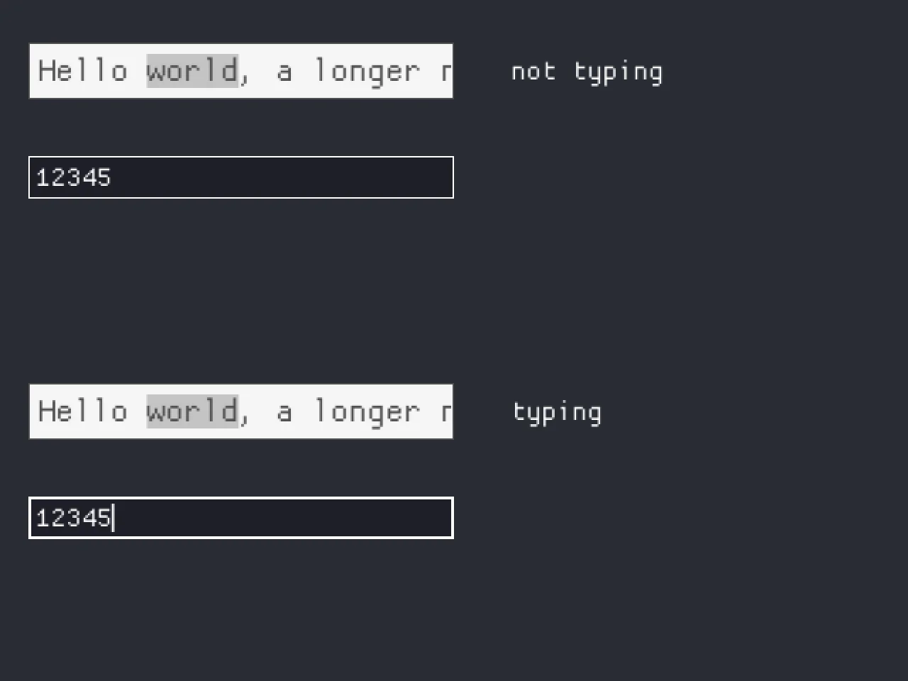
Two edits of a form drawn with DrawTextEdit at 640 by 240, doubled, the name in the default look
with "world" selected and its text kept inside the border, and the seed in a font and colors of the
program's own, above before a click and below after one gives the seed the keyboard, its border two
pixels wide and its caret after the last digit.

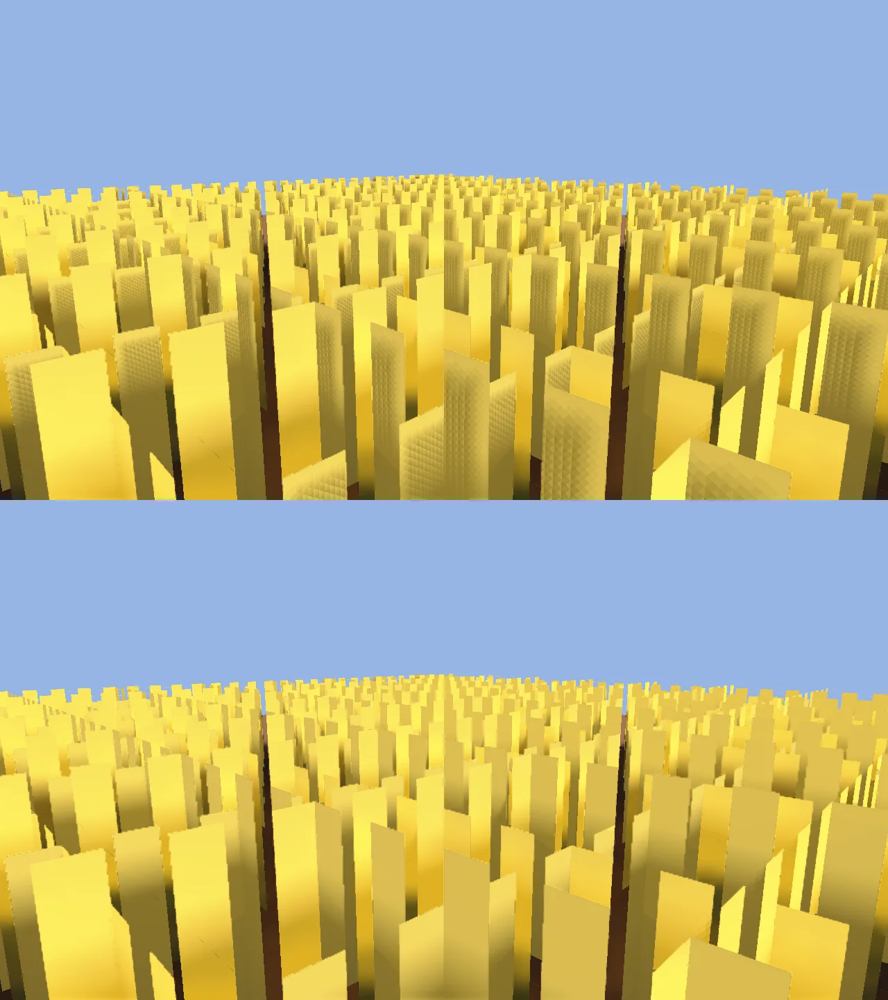
A field of wheat's cut-out two-sided walls a block tall as the voxel game draws its crops, under its
sun at ten in the morning, at High at 1280 by 720, above with the shadow's point moved along each
wall's normal as given, the walls lit from their backs shadowing themselves in speckles, and below
with it turned to the sun's side, every lit wall even.

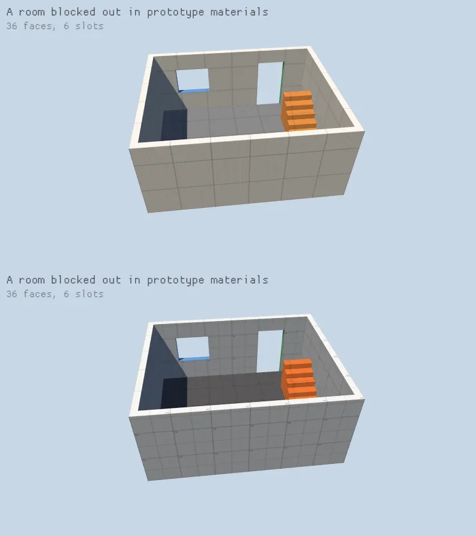
The models_edit_mesh_room example at 800 by 450, above in the prototype colors and grid before, the
walls a pale warm gray and lines every tenth of a meter, and below in Unreal's prototyping grays and
orange with lines at the half and the quarters and 1m lettered in each cell's corner, as
BevyCSharp's.

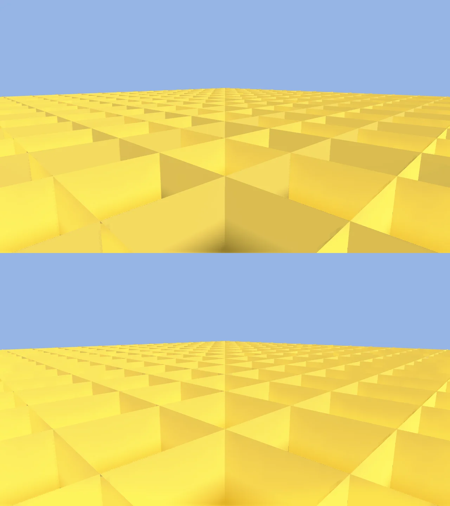
The wheat room's thin two-sided walls half a unit apart at High at 1280 by 720, above with the
screen's probes looked up along each wall's normal as given, the walls seen from their backs taking
none and reading darker than those seen from their fronts, and below along the normal turned to the
eye, both kinds alike, 44% and 45% over a path-traced reference by the field's thin-wall band, item
131's to mend.

The sun given a width across (`SetShadowSoftness`), read on the engine's tree against `a16227a7`.
The edge of a pole's shadow, 5 units tall under a sun 45 degrees up, between a quarter and three
quarters of the light, in units across:

| Sun | at the foot | at the tip |
|---|---|---|
| no width | 0.04 | 0.04 |
| 3 degrees, read over twice the sun's spread | 0.14 | 0.27 |
| 3 degrees | 0.08 | 0.24 |

The GPU's scene pass, `./e3d command profile`, the frames unlimited, other programs holding part of
the GPU through some readings, those of a global illumination time off its own kept out:

| Scene | no width | 0.53 degrees | 3 degrees |
|---|---|---|---|
| voxel grove, Low, 1920 by 1080 | 6.53 to 6.72 ms | 7.44 to 7.88 | 7.55 to 7.76 |
| voxel grove, High, 1920 by 1080 | 7.26 to 7.31 | 7.96 to 8.39 | 7.94 to 8.41 |
| bounce rooms, Cornell box, Low, 800 by 450 | 0.41 to 0.43 | 0.46 to 0.47 | |
| bounce rooms, Cornell box, Low, 1920 by 1080 | 1.71 to 1.72 | 2.03 to 2.06 | |

The grove's 0.53-degree readings with no way out in the shadow's core were 7.70 to 7.88 ms at Low
and 8.17 to 8.26 at High, and the rooms' were taken before it.

The plane a program sets for its glossy surfaces to mirror the scene in (`SetReflectionPlane`),
read on the engine's tree against `7af16fcd`, on an RTX 4070 under tuned's `powersave-bazzite`.
The picture's water mirrors the bank through a copy of the voxel game whose water shader lays
`mirrored` over the sky its fresnel term shows, which the game's own shader does not yet do; the
game's river at seed 1 has its top at 48.875, a source block's eighth under the block's top.

The `mirror` node in `./e3d command profile`, the frames unlimited, other programs holding part of
the GPU through some readings, those of a global illumination time off its own kept out, in ms:

| Scene | Size | GPU | CPU |
|---|---|---|---|
| `shaders_reflections`, off | 800 by 450 | 0.046 | 0.11 to 0.13 |
| `shaders_reflections`, High | 800 by 450 | 0.12 | 0.13 to 0.14 |
| `shaders_reflections`, off | 1920 by 1080 | 0.088 to 0.089 | 0.11 |
| `shaders_reflections`, High | 1920 by 1080 | 0.26 to 0.27 | 0.16 |
| Summit, a sea added at -0.5 | 960 by 540 | 0.10 | 0.15 |
| Summit, a sea added at -0.5 | 1920 by 1080 | 0.16 | 0.15 to 0.17 |
| voxel grove, Low | 800 by 450 | 1.27 to 1.63 | 4.0 |
| voxel grove, High | 800 by 450 | 1.52 to 1.70 | 4.1 |
| voxel grove, Low | 1920 by 1080 | 1.53 to 1.54 | 4.0 |
| voxel grove, High | 1920 by 1080 | 2.00 to 2.06 | 4.0 to 4.1 |
| voxel river, Low | 1920 by 1080 | 2.17 | 3.7 |
| voxel river, High | 1920 by 1080 | 2.48 to 2.79 | 3.8 |

The grove is the view item 125 read, at -736, 79, -960 facing 345, with the plane at 49, little of
the river in sight; the river is the picture's view, at -715, 53, -1040 facing 20, with the plane at
48.875. The game's frame, bound by the CPU, took 23.6 to 25.4 ms without the plane and 28.0 to 30.6
ms with it in the grove, and 23.8 to 25.3 and 26.3 to 28.3 ms at the river. The window's depth pass
took 4.1 ms of the CPU for the same 2,241 draws. Before the batches wholly under the plane were
culled, the grove's mirror took 4.5 to 4.6 ms of the CPU and 1.45 to 1.93 ms of the GPU.

The test's floor under a red cube, its red less its green where the cube's front mirrored in the
floor falls, reads 57 with the plane and -3 without it, and 0 and -3 to the cube's side.

A ray crossing a canopy's leaves shaded twice at most, the first leaf it crosses for every one and
the surface it stops at once, read on the engine's tree against `78946b22` in a copy of the voxel
game at its commit `48e5bea`, the leaves letting 0.5 through a unit and the plants 0.71, on an
RTX 4070 under tuned's `powersave-bazzite`, the frames unlimited, other programs holding part of
the GPU through some readings, those of a scene pass off its own kept out.

Global illumination at seed 1's cherry grove, item 125's view, at 1920 by 1080, in ms, against the
rays stopping at the leaves as at solid ones (`./e3d command gi.toggle through off`):

| Quality | Stopping at the leaves | Each leaf shaded where crossed | Shaded twice at most |
|---|---|---|---|
| High | 3.30 to 3.53 | 5.93 to 6.23 | 5.25 to 5.42 |
| Low | 1.43 to 1.64 | 3.12 | 2.49 to 2.51 |

What crossing the leaves took at High, the crossing left in one stage at a time, in ms:

| Stage | Each leaf shaded where crossed | Shaded twice at most |
|---|---|---|
| The cascades' rays | 1.6 | 1.4 |
| The screen's probes' rays | 1.1 | 0.46 |
| The merge | 0.2 | 0.13 |

Read before the change, with each leaf shaded where crossed, a build crossing one leaf at most took
5.45 to 5.47 ms at High, one that shaded nothing past that leaf 4.69, one that left the march
through the leaf's depth out 5.53, and one keeping the crossing's loop with nothing crossed 3.81
against 3.41 to 3.45 with the solid build. After it, a bound of one crossing read 5.05 to 5.07 and
one of two 5.19 to 5.25 at High, 2.28 and 2.42 at Low.

Item 100's canopy of clumps over the eye at 800 by 450, the leaves letting 0.6 through, took 0.62
and 1.01 ms at Low with the crossing off and on and 1.60 and 2.30 at High, where before 0.61 and
1.09 to 1.12 and 1.55 and 2.50 to 2.57. The bounce rooms at 1920 by 1080, where nothing lets light
through, took 0.75 ms at Low and 2.08 to 2.16 at High, where before 0.81 and 2.19 to 2.31.

The picture's two frames differ by 0.2 of 255 on the whole and by 0.1 to 0.6 on the floor under the
trees. A floor under a canopy of leaf blocks twenty a side and two deep, lit by the sky alone, takes
the same share of the sky's light to four places either way, 0.30 at High two and a half units
under it, 0.17 at Low, and 0.23 at High five and a half under it.

The screen's probes on thin two-sided walls, read on the engine's tree against `7ff7bbdd` on an RTX
4070 under tuned's `powersave-bazzite`, in item 89's room built as the voxel game's wheat field,
eight by eight blocks of four walls a block tall half a unit apart under the game's sun at ten in
the morning, at High against path-traced references of 256 paths a pixel.

The walls against the reference by kind, those facing the eye and the sun and those seen from their
backs, weighted by pixels, close and from further off:

| Screen's probes | Close, front | Close, back | Far, front | Far, back |
|---|---|---|---|---|
| looked up along the normal as given | +44.0% | +18.3% | +13.7% | -0.1% |
| left out (`gi.toggle screen off`) | +13.5% | +18.1% | | |
| looked up along the normal turned to the eye, kept | +44.1% | +44.8% | +13.9% | +7.9% |
| a blind probe left out whole, not kept | +14.9% | +19.3% | +1.7% | -0.5% |
| a blind probe's rays reading the world's probes, not kept | -0.8% | -0.6% | -3.7% | -6.0% |
| a blind probe's march passing surfaces it leaves, not kept | +29.5% | +29.5% | +9.6% | +3.8% |

A probe is blind where the field reads a surface a cell off its surface, as everywhere between two
walls half a unit apart, two cells of a quarter, whose bands of half a cell meet. The probe under
one front wall's pixel read 255% over the reference along its sixteen ways, its rays met within 0.11
of their start, each taking the wall's own light, 1.265 in red where the reference along the same
ways read 0.1 to 0.6; started a cell off its wall it read 300% over. Left out whole, the probes
still traced among the blind ones drew bright patches a tile wide. Reading the world's probes, a
closed room's thin walls let in the light outside them, a closed room at High 0.0062 of the open
floor's light where under 0.002 is held, a lamp's room 12.7 where under 8, and a slab's red on a
wall 1.20 where the reference's 1.24. Passing surfaces a ray leaves kept those rooms closed.

The test's two walls over a red emissive slab, one seen from its front and one from its back, take
1.560 and 1.000 of their red with the screen's probes against without them, looked up along the
normal as given, and 1.560 and 1.515 along the normal turned to the eye.

A thin two-sided wall's shadow read along its normal turned to the light's side (`litSide` in
`lights.slang`), read on the engine's tree against `0a4ad922` on an RTX 4070 under tuned's
`powersave-bazzite`, in a room built as the voxel game's wheat field, eight by eight blocks of four
walls a block tall on farmland, one wall of each pair facing away from the sun, under the game's sun
at ten in the morning, toward 0.479, 0.830, 0.287, at High at 800 by 450 against a path-traced
reference of 256 paths a pixel.

Each wall's standard deviation over its mean, weighted by its pixels, and the walls' mean error
against the reference:

| Shadow's point moved along | Close view, spread | Far view, spread | Close view, error | Far view, error |
|---|---|---|---|---|
| the reference | 0.053 | 0.074 | | |
| the normal as given | 0.149 | 0.338 | 29.4% | 28.9% |
| the normal turned to the light's side | 0.054 | 0.227 | 31.6% | 12.5% |
| that and a step toward the light as the sun grazes | 0.054 | 0.227 | 31.6% | 12.4% |

The mean step between neighboring wall pixels at Off, which speckles raise, read 14.85 in the far
view and 6.76 in the close one with the normal as given, 4.52 and 1.61 turned to the light's side,
12.50 and 5.65 with the step toward the light alone, and 4.48 and 1.60 with both.

What is left of the far view's spread is a soft darkening of the outer walls' lower halves, the
indirect light's and no speckle. The walls' level against the reference is the screen's probes',
read by kind with the shadow turned, the walls seen from the front 44.0% over and those seen from
their backs 18.3% over, and with the screen's probes left out (`gi.toggle screen off`) 13.5% and
18.1%; a wall seen from its back takes no screen probe, since the model pass looks them up along the
normal as given, and looked up along the turned one both kinds read 44.1% and 44.8% over. Item 129
reads that excess before the lookup is turned.

The test's two walls under the same sun, one lit from its front and one from its back, read 0.4403
each and even with the normal turned, where the second read 0.1909, spread 0.298 of its mean.

Done that day

- Item 89 at `b05b32da`. Thin two-sided masked faces carry no shadow acne.
- Item 91 at `d207627e`. DESIGN.md says the loop and the ECS are both the engine's way, each where
  it fits, with the voxel game as the model (Decision 68).
- Item 93 at `bb542fa4`. No running sentence holds a colon, across the documents, the comments and
  the scripts.
- Item 95 at `5528c55c`. A verb of ./e3d with --help prints its help and opens nothing.
- Item 100 at `a16227a7`. The field lets a share of light through a cell marked as foliage.
- Item 111 at `45edfbf6`. The sun's shadow softens with the distance from its caster.
- Item 112 at `78946b22`. A flat surface mirrors the scene through a planar reflection a program
  sets.
- Item 127 at `2f5237f2`. A ray crosses a voxel canopy's many leaf surfaces for less.
- Item 128 at `0754b975`. The interface has a text field to type into.
- Item 129 at `969a1b08`. The screen probes do not over-light thin two-sided walls.
- Item 130 at `7ff7bbdd`. The prototyping look takes Unreal's tones and a level editor's grid steps,
  as BevyCSharp's.

## 2026-10-25

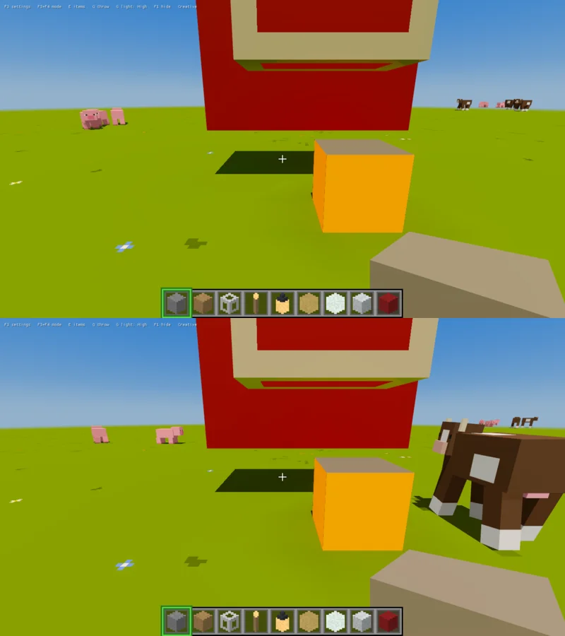
The voxel game's play check, two panes of glass with a gray frame before a red concrete wall on its
flat world at noon, the far cascade at the far plane, above before the mend, the frame olive with
the low sky's blue taken by the far cascade's slab, and below after it, as gray as with no far
cascade.

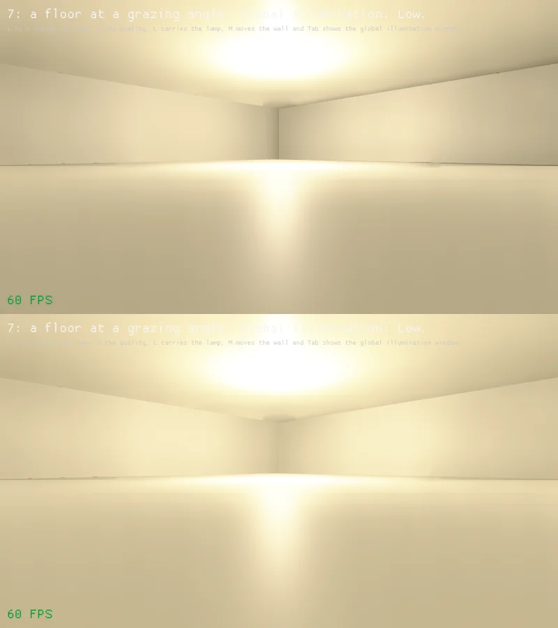
The bounce rooms' floor at a grazing angle at Low with a far cascade at the far plane, above with
the last counted cascade merging the far cascade's probes, 0.108 of its light from its reference,
and below with it tracing to the field's edge itself, 0.069.

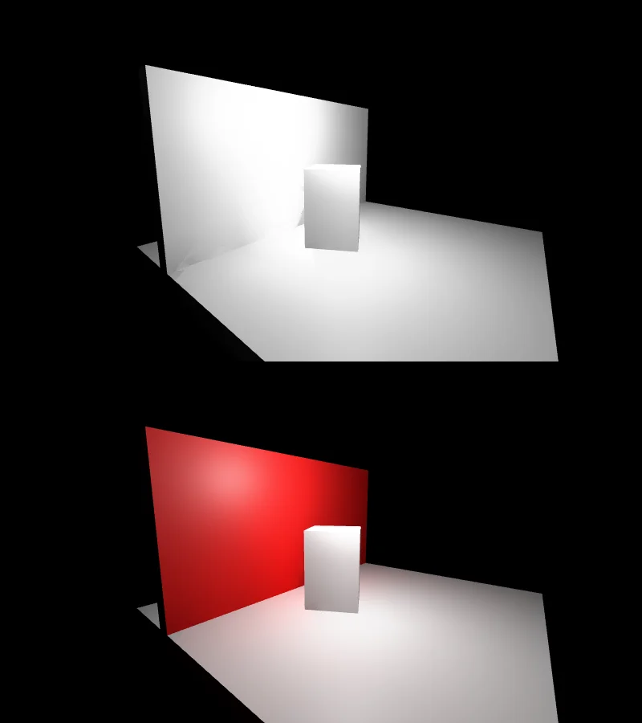
The red wall's room with the wall a compute shader writes in a stream of two uints a vertex, lit by
a shader of its own, above with no colors given, the floor before it 233,233,233, and below with its
colors given beside the stream, the wall red and the floor 222,192,192 with the red it bounces.

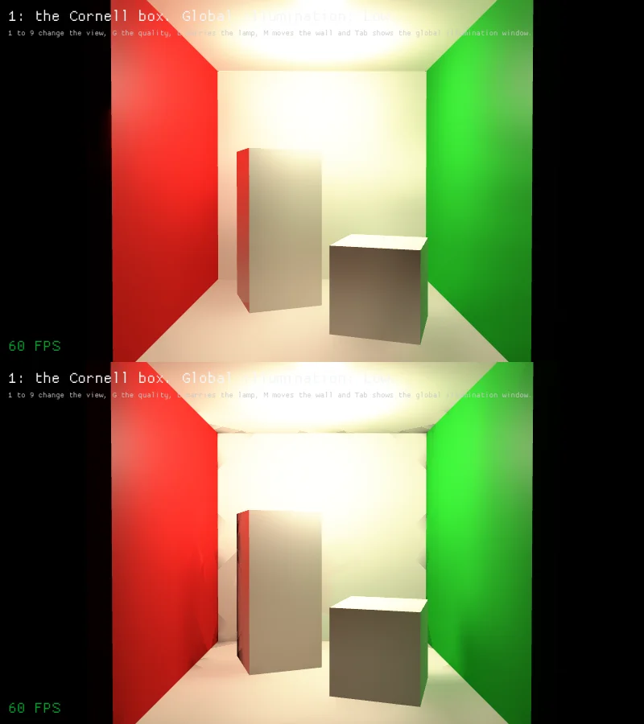
The Cornell box at Low, above with the screen's probes, its global illumination 1.80 ms of the GPU
at 800 by 450, and below with Low leaving them out, 0.60 ms, 0.099 of its light from its reference
where 0.115, the ceiling's edges and the tall block's foot a little stepped.

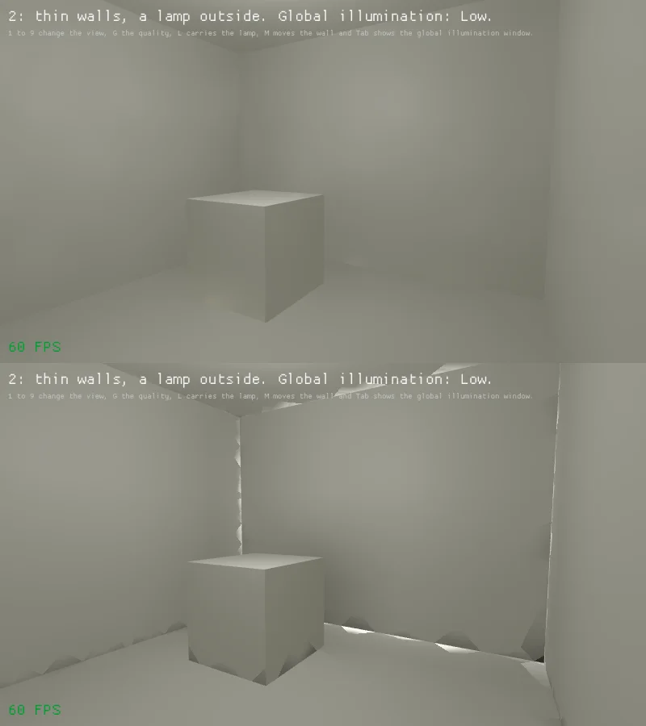
The bounce rooms' thin walls with a lamp outside at Low, above with the screen's probes, 0.078 of
its light from its path-traced reference, and below with Low leaving them out, the cascades read
alone, 0.117, the lamp's light stepping through the walls' foot and their corners where nothing
under the probes' spacing holds it back.

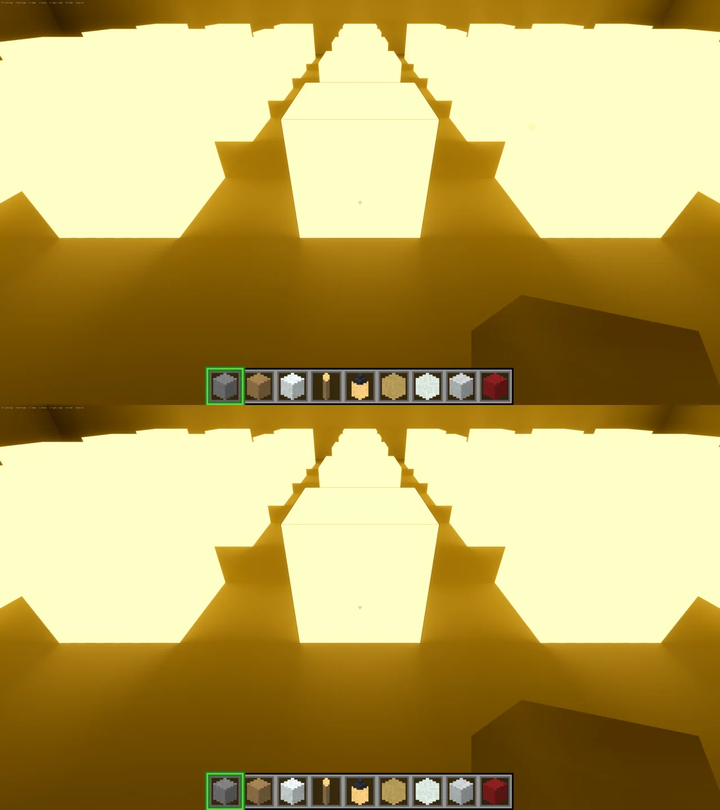
The voxel game's room of forty glowstones at night at 3840 by 2160 at High, scaled to 1280 by 720,
above with the screen's probes every 8 pixels, global illumination 35.9 ms, and below every 16, 13.3
ms, the two alike to the eye.

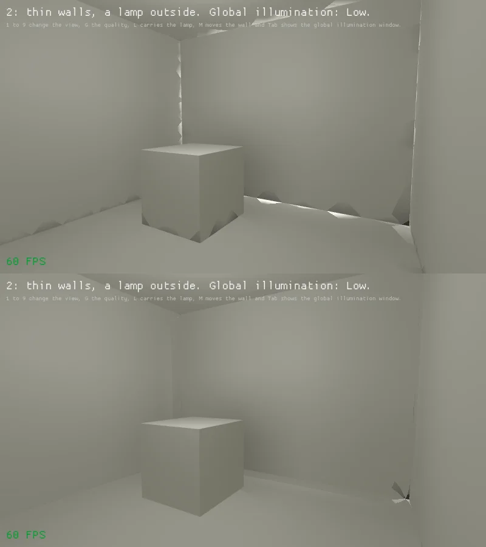
The bounce rooms' thin walls with a lamp outside at Low, above with each pixel reading the world's
probes by their reach, the lamp's light in triangles along each wall's foot, and below with a pixel
by a wall thinner than a cell reading them through the field, the floor along the foot as dark with
the lamp outside as without it, a speck left in the far right corner.

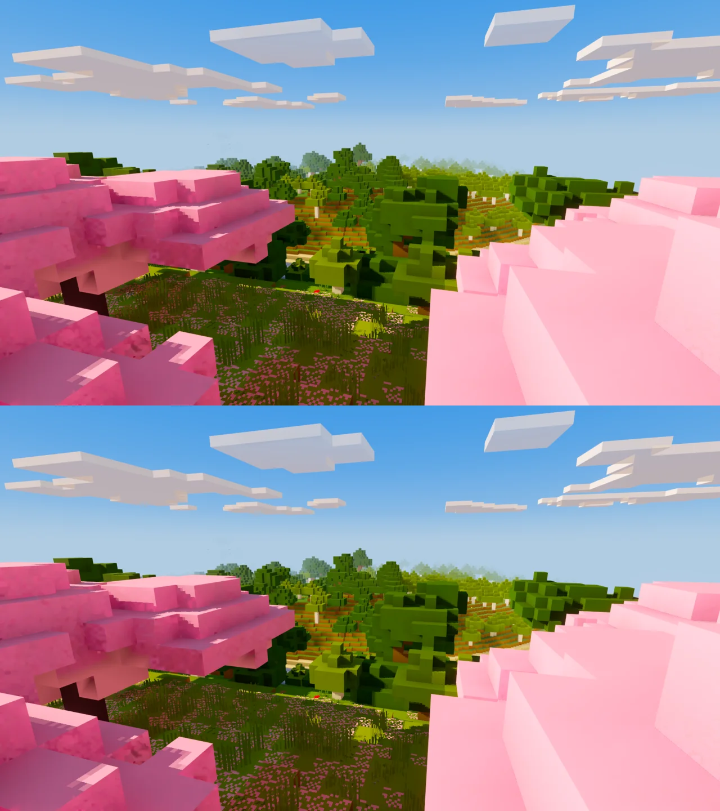
The voxel game's cherry grove at High at 1920 by 1080, scaled to 1280 by 720, above with every pixel
no screen probe like its own stands near marching to the world's probes through the field, the scene
pass 12.1 to 15.4 ms, and below marching only by a wall thinner than a cell, 9.7 to 11.1 ms, the two
alike to the eye, 70 pixels of two million apart by more than 3%.

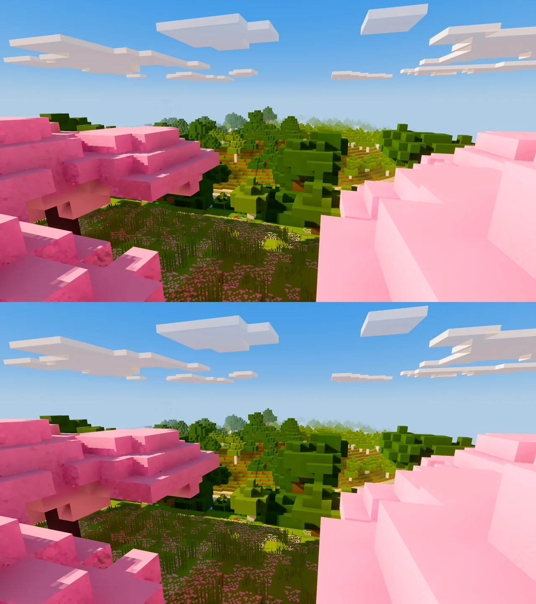
The voxel game's cherry grove at High at 1920 by 1080, scaled to 1280 by 720, its sections drawn
through DrawMesh, above in the order the game drew them, the scene pass 14.4 to 21.2 ms with another
program on the GPU, and below by pipeline and nearest first, 8.9 to 12.9 ms, the two alike to the
eye, an RMSE of 0.0011.

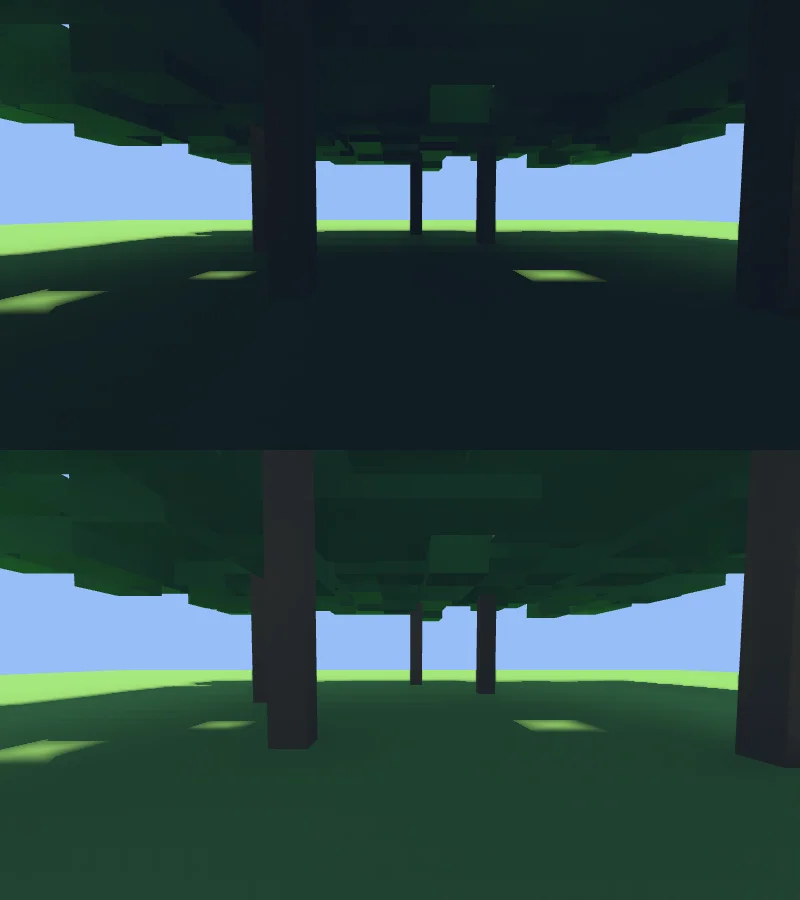
Block trees over grass at noon at High at 800 by 450, the floor and the leaves matte, above with the
canopy's leaves solid, the floor under it 0.007 in linear light, and below letting 0.6 of the light
through a unit, the floor 0.041, the sun's shadow alike.

What a canopy lets through, read on a scratch program of block trees over grass at noon at High,
800 by 450, the floor and leaves matte, the canopy of 2 by 2 leaf blocks 1 or 2 deep at 5.5 to 7
units up, solid or letting 0.6 through a unit. The floor under it, in linear light:

| Canopy | floor |
|---|---|
| solid | 0.007 |
| letting 0.6 through, before the reach and the merge were mended | 0.008 |
| letting 0.6 through, mended | 0.041 |

The share of the sky's light a solid slab holds back that a floor takes under a slab letting half
through a unit, against what the slab's depth along each way gives:

| Slab | geometry | Low | High |
|---|---|---|---|
| 20 across, 2 units up | 0.36 | 0.36 (0.23 before) | 0.40 (0.29 before) |
| 20 across, 5 units up | 0.41 | 0.37 | 0.32 |
| 30 across, 5 units up, the test's canopy | 0.38 | | 0.31 (0.004 before) |

Global illumination's time where nothing is marked, and where leaves fill the view:

| Scene | before item 100 | with it |
|---|---|---|
| voxel grove, Low, 800 by 450 | 1.22 to 1.44 ms | 1.21 to 1.51 |
| voxel grove, Low, 1920 by 1080 | 1.47 to 1.49 | 1.46 to 1.48 |
| voxel grove, High, 800 by 450 | 3.28 to 3.33 | 2.85 to 3.21 |
| voxel grove, High, 1920 by 1080 | 4.24 to 4.60 | 3.35 to 3.38 |
| canopy, Low, solid then letting 0.6 through | 0.60 | 1.10 |
| canopy, High, solid then letting 0.6 through | 1.53 | 2.49 |

The screen probes at four resolutions, read in the voxel game's room of forty glowstones with global
illumination at High, offscreen, with another session's tests sharing the GPU so every time runs high
alike. The scene pass is the probes' own cost; the two global illumination columns are the whole of it
with the probes every 8 pixels at any screen, and with the spacing grown by the window's height (item
122).

| Resolution | scene pass with probes | global illumination, every 8 pixels | global illumination, spacing by height |
|---|---|---|---|
| 1280 by 720 | 2.6 ms | 8.3 ms | 8.3 ms |
| 1920 by 1080 | 4.9 ms | 13.7 ms | 13.1 ms |
| 2560 by 1440 | 7.6 ms | 17.8 ms | 12.4 ms |
| 3840 by 2160 | 16.2 ms | 35.9 ms | 13.3 ms |

The probes' spacing grows with the window's height, 8 pixels at 1080p, 11 at 1440p and 16 at 4K, so a
probe covers the same patch of the world at any screen. Global illumination at 4K drops from 35.9 to
13.3 ms, about what 1080p costs, and the bounce rooms at 4K read within 0.002 of their 1080p distances
to the path-traced references in every view, where a fixed 8 pixels at 4K had drifted. Low's glow-only
pass costs 4.5 ms of global illumination at 4K and the per-pixel march would cost 108 ms, so the
quality ladder of item 103 matters there as expected.

The thin walls' leak at Low and what its mend costs, with global illumination at Low, where no
screen probe stands. The bounce rooms' thin room's floor along its walls' foot is read in linear
light at 480 by 270 by its test, with the bright lamp outside and without it; the voxel game's two
scenes are read at 1920 by 1080 offscreen on a scratch copy of the game, the share of pixels
marching counted from a frame that paints them (item 123).

| Form | thin room's floor, lamp outside / without | voxel room, scene pass | voxel spawn, scene pass |
|---|---|---|---|
| each pixel by the probes' reach | 0.303 / 0.196 | 2.6 to 2.8 ms | 6.0 to 7.4 ms |
| march where another surface is near | no triangles to the eye | 5.1 to 5.2 ms | 8.2 to 8.3 ms |
| march by a wall thinner than a cell | 0.207 / 0.207 | 3.1 to 3.2 ms | 6.1 to 6.3 ms |

The leak came from a pixel's read of the probes across a wall thinner than the field's cell, its
reach judged from a point inside the wall's cells, and not from the probes' rays or the field. In
the voxel game the thin-wall form marches 0.5% of the room's pixels and 0.75% of the spawn's, slivers
at a few blocks' corners, where marching wherever another surface stands near cost 2.5 ms. A speck
where the thin room's right and back walls meet its floor stays.

Why the voxel game's scene pass took twice as long with its sections drawn through `DrawMesh` as
with the same sections as mesh entities, read on scratch copies of the game at `b7608c7`, one as it
is and one with its chunk renderer of `ddede23`, both on the engine at `23b4793b`, in seed 1's
cherry grove at 1920 by 1080 at High, offscreen, the frames unlimited. The two paths make the same
draws through the same pipelines, culled alike, with the same depth state and the same coverage of
the depth pass; what differs is the order. A section's solid faces, its faces cut out and its lava
came by turns, each a batch alone through the terrain shader's solid pipeline or its cut-out one,
so the pass bound a pipeline 315 times a frame, against 7 for the entities.

| Sections drawn | GPU scene pass, ms |
|---|---|
| through `DrawMesh`, in the game's order | 13.1 to 14.1 |
| as entities, in their order | 9.3 to 10.8 |
| through `DrawMesh`, nearest first | 11.8 to 13.0 |
| through `DrawMesh`, by pipeline | 9.2 to 10.6 |
| through `DrawMesh`, by pipeline and nearest first within it | 8.4 to 9.0 |

The model pass draws a view's opaque batches by their pipeline and nearest first within it, each
run between two batches that write no depth apart. With another program holding part of the GPU,
the sections through `DrawMesh` read 8.9 to 12.9 ms with it where 14.4 to 21.2 without, and as
entities 12.4 to 14.6 where 10.5 to 15.0, the frames within the spread two runs of one build show.
In the thousand meshes of item 108, in Release, the order costs 0.03 to 0.15 ms of the pass's
recording where all are of one pipeline, and takes 0.6 to 0.8 ms off it through `toon.slang` with
the solid and the cut out by turns, for `DrawMesh` and entities alike.

Where the scene pass's time goes at High in the voxel game's cherry grove, seed 1 at 1920 by 1080,
offscreen on a scratch copy of the game at the engine's HEAD (item 96). A pixel that no screen probe
on a surface like its own stands near, 9.1% of the grove's, its leaves, grass and far blocks, read
the world's probes by marching the field toward each of eight, as the thin room's corner needs; a
world of blocks has no wall thinner than a cell, so the march runs only by such a wall.

| Form | scene pass, rounds of two readings |
|---|---|
| marching at every such pixel | 13.07, 13.08; 12.11, 12.11; 15.41, 15.35 ms |
| marching by a thin wall alone | 10.53, 10.57; 11.13, 10.84; 10.00, 9.66 ms |
| no march at all | 8.6 to 9.3 ms, the thin room's corner then 2.17 times its wall |
| no read of the world's probes | 7.7 to 7.9 ms |

Other programs held part of the GPU through every round, so the rounds run apart by as much as 3 ms;
within each the gated form read 1.0 to 5.4 ms less. A half-size pass gathering the world's probes
once a two by two of pixels, read first, gave nothing, reading 11.9 to 12.1 ms at High and 8.75 to
9.16 at Low with it and without, since the cost was the march and not the gather it stood in for.

Done that day

- Item 96 at `21a3fbc7`. The scene pass reads the cascades' light at a cost under the trace's, not
  twice it.
- Item 102 at `f05ea96f`. The far cascade's coarse cells near the ground hold no slab, so the game
  can set it.
- Item 103 at `c721746b`. The screen probes have one switch, and off means no screen pass at all.
- Item 108 at `a8f127ad`. A mesh entity can be a voxel game's section, with its own shader, streams,
  visibility and shadow.
- Item 110 at `31d1fcb6`. A behavior's system says what it runs after or before, and in more than
  one state.
- Item 113 at `0cfc2843`. A behavior reads the mouse's wheel through its context.
- Item 114 at `e746f98e`. An empty emitter costs nothing.
- Item 115 at `6e29cfa0`. A particle can face a set direction rather than the camera.
- Item 116 at `55a33ce9`. A program's profile value can be a mean over a window.
- Item 117 at `c897565c`. An index whose key names many entities.
- Item 118 at `07d3bf28`. A played-out voice is let go, and Tick walks the live ones alone.
- Item 119 at `6a20d165`. The dummy driver drains a one-shot voice as a device does.
- Item 120 at `ac1c6bad`. A voice takes a low-pass by cutoff and a room's reverb by wet share, size
  and decay.
- Item 121 at `9a013b59`. A mesh over shader buffers carries a color stream beside the program's own
  and can lie in a range of a shared buffer.
- Item 122 at `ac46c010`. The screen probes read at 1440p and 4K, and their spacing grows with the
  resolution where the reading says so.
- Item 123 at `17da0eaa`. The world's probes alone do not leak a lamp along a thin wall's edges, so
  Low stands on its own.
- Item 124 at `23b4793b`. A mesh entity can cast no shadow and bounce no light.
- Item 125 at `98a0e49e`. Why the scene pass halves when a game's meshes are entities, and whether
  DrawMesh can have it too.
- Item 126 at `42f4f505`. The ECS Material and ModelMaterial agree on their defaults.

## 2026-10-24

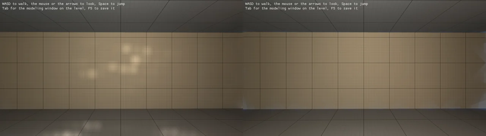
Blockout's wall under its lamp with the screen probes on and left out; the round spots are the
probes' own, the ceiling's bright patch narrower than a texel read by a few fixed rays (item 71).

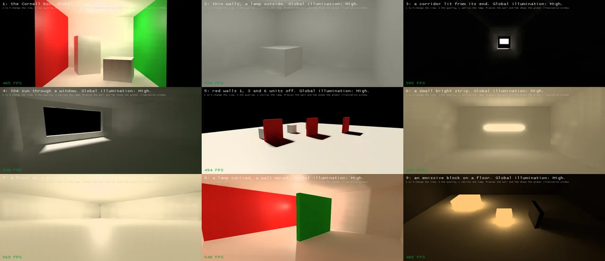
The nine views of the bounce rooms as the readings take them, the Cornell box, the strip, the
corridor and the rooms with a window.

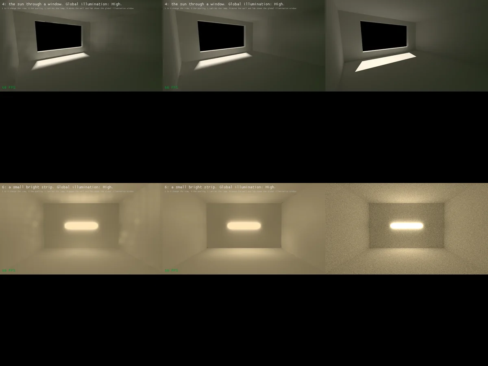
The bounce rooms' noise, views with the screen probes on and off beside their path-traced
references, the still spots the sixth term's and the sunlit floor under a window its third form
(item 71).

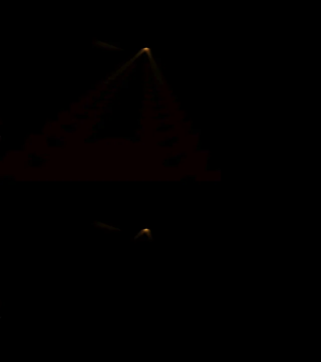
The edge leak at eight times its brightness, a glow light's fan at the foot of the edge two blocks
meet, before the mend above and after it below, the checkerboard cell held inside the field (item
71).

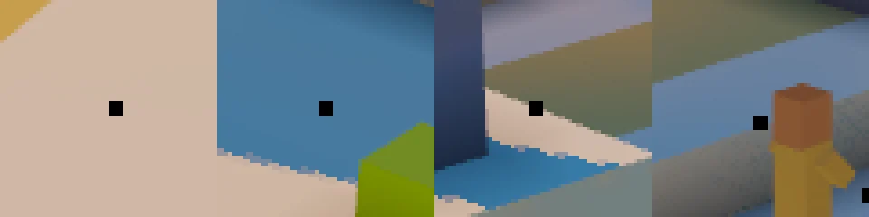
Item 90's reading at the desert village view, the glow texels whose normal is a non-number, marked,
which the screen probes' history keeps and spreads as black.

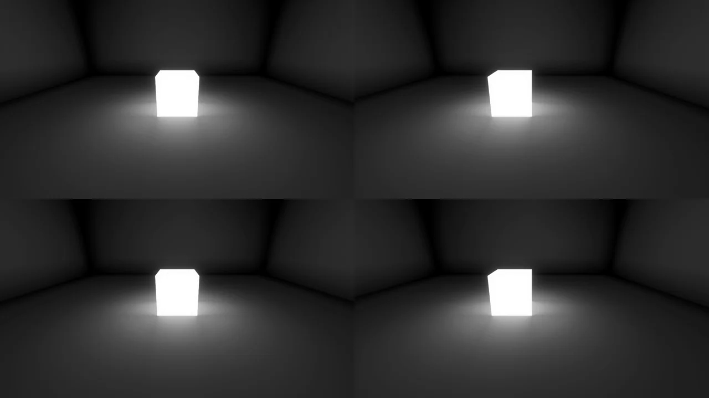
A lantern room before and after the eye steps half a block, with the screen probes on and left out;
the sixth term's spots stand at new places after the step while the lamps move by parallax alone
(item 71).

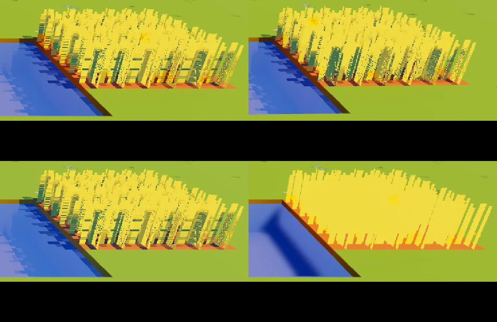
A wheat field's thin walls in the voxel game as it ships and with its lighting turned back part by
part; the speckled stripes are the shadow map's acne on two-sided masked faces, not faces fighting
(item 71, item 89).

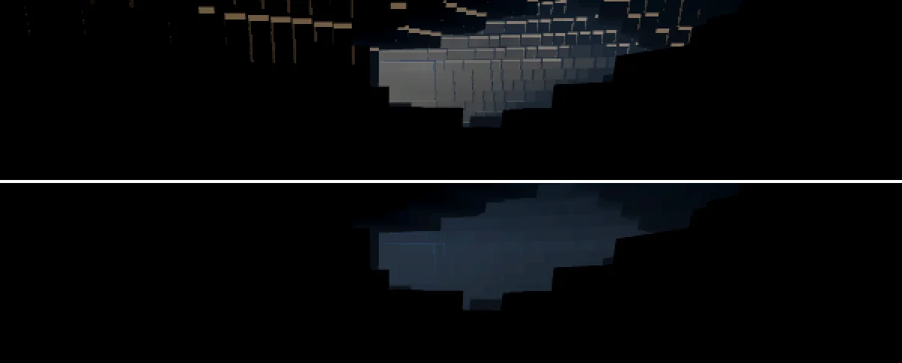
The deep cave's tops 45 blocks in at noon, above with the game drawing only the sections its eye
sees and the sun on the tops and their edges, below with every section drawn, the levels three times
their own.

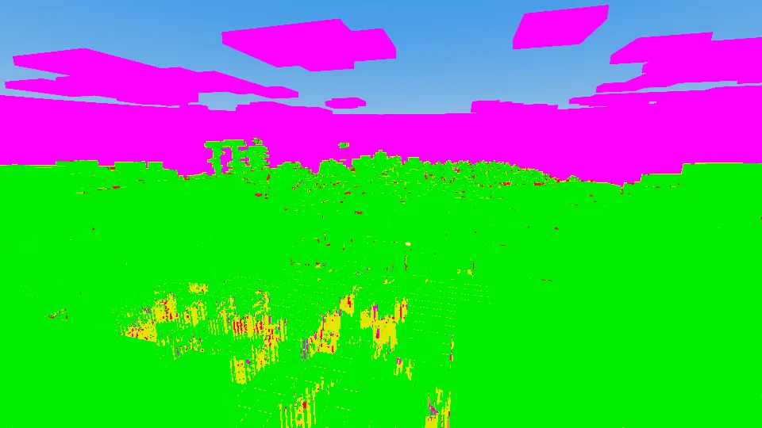
The voxel game's cherry grove at 1920 by 1080 with each pixel colored by how the glow lights' read
left it, green for a texel like its own, yellow for any texel, red for a march an ask sent it to and
magenta for a march with no texel, the far land and the clouds a fifth of the frame.

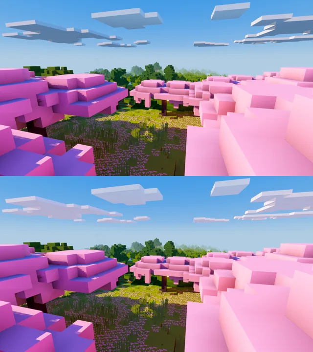
The cherry grove the scene pass is timed at, drawn on 5.2.215 above and on the engine's HEAD below.

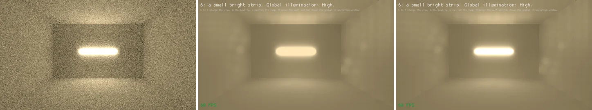
The bounce rooms' strip lamp, its path-traced reference at the left, the engine's curve holding the
lamp's hue cream in the middle, and the highlight knee taking it to white at the right.

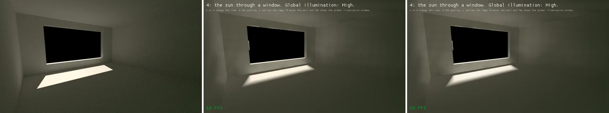
The bounce rooms' window, its path-traced reference at the left, the engine's curve in the middle,
and the highlight knee at the right, the sun's patch on the floor a little less yellow.

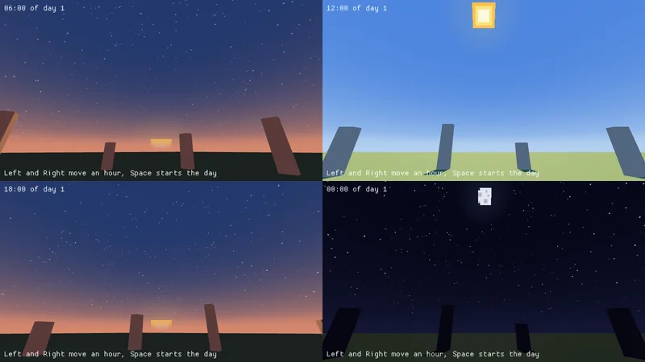
The day sky example's capture holds it at six, at noon, at eighteen and at midnight in one picture,
Summit's is taken again under its day sky, and the README's gallery shows the example. (`49d834e1`)

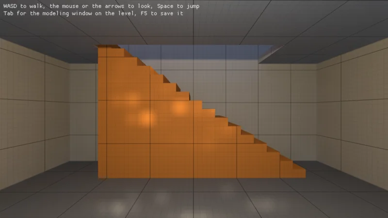
Blockout's capture looks from the hall up its stairs, and the README's gallery shows it among the
games. (`ddc20382`)

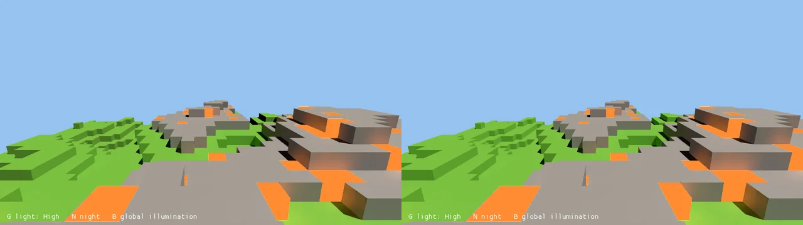
RENDERING.md shows Ore past a field's edge set on its land, without the distant ambient and with it,
its far grass and hills up to 59 levels apart. (`522c662a`)

Done that day

- Item 63 at `b6d822ee`. A game that is a level blocked out with the tools, Blockout (Decision 51).
- Item 72 at `14338c8f`. The sun's shadows and the scene field reach the far plane through a fill
  cascade each, not counted, with a distant ambient past the field's edge (Decision 55).
- Item 74 at `4c629a7c`. The scene field's builds are budgeted in triangles a frame, so many meshes
  arriving at once do not stall one frame.
- Item 75 at `6ee3c87b`. The sky below the horizon takes the fog's color, so a fogged edge meets the
  color it fades into (Decision 57).
- Item 77 at `7549a0f9`. A day sky driven by the hour, the sun's light following it, with the sun,
  the moon, the stars and the dusk, from the voxel game's numbers (Decision 57).
- Item 88 at `26dbc6da`. The tests that lend the console run in one collection, and an eval with no
  world lent refuses rather than throws.
- Item 90 at `d52d1781`. A small emitter's light never reaches the screen's probes as a non-number,
  and whatever gives one is mended.
- Item 92 at `b888b242`. The window runs under X11 on Linux for the present (Decision 69).
- Item 94 at `b5741f88`. A cave under the ground sees no sun on its blocks' tops.
- Item 98 at `391bbfd7`. The scene pass at HEAD costs what 5.2.215's does, the probes' info read in
  place.
- Item 99 at `e2a203d9`. A program places the shadow light's shadow read within `litLight`, so a
  stepped shadow costs one read.
- Item 101 at `e5ad8d28`. A mesh is drawn into the shadow maps alone, so a game that culls its view
  keeps its casters.
- Item 104 at `267d3886`. A test runs an app's behaviors through the package.
- Item 105 at `f0574e89`. A Query reaches past three components.
- Item 106 at `df0c7b50`. A behavior holds what it needs, or the guide says why not.
- Item 107 at `a0d3d7f7`. An entity is found by a component's key, so a game keeps no index of its
  own.
- Item 109 at `8ae947ee`. Highlights roll off to white a channel at a time above a knee, the rest of
  the picture as it is.

## 2026-10-23

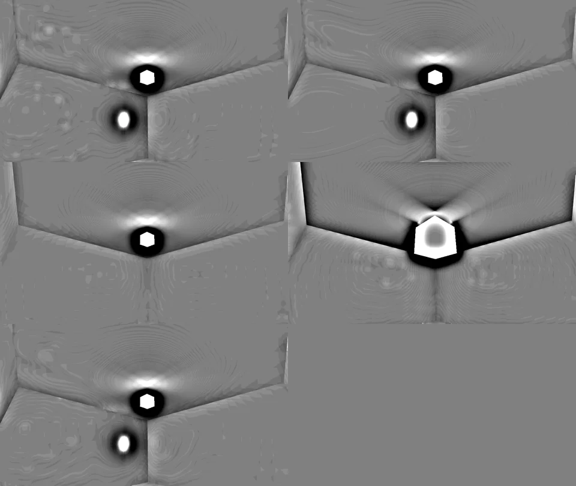
The blotches read as contour bands of the light around a small emitter at four headings, the round
spots its near field caught by one fixed probe ray, the sixth term of where the method stops (item
71).

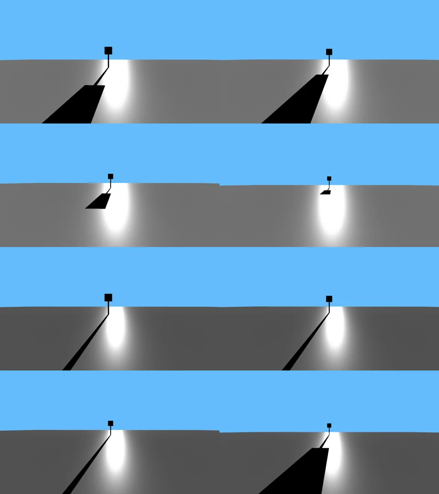
The sun's cascades at a low sun with their seams mended, a long shadow held across them (item 83).

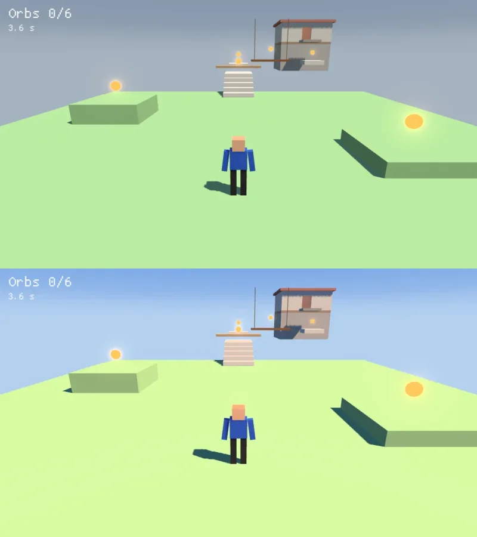
Summit before and after the sky below the horizon took the island's gray blue, so the fogged edge of
the land meets the color it fades into (item 75).

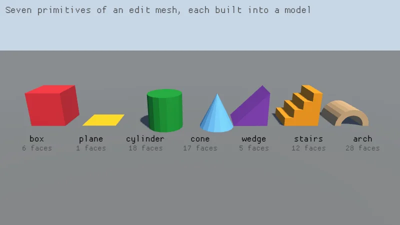
The models_edit_mesh example shows the seven primitives of an edit mesh, each built into a model and
named with its faces, and the upgrading page names every modeling call. (`91c8d363`)

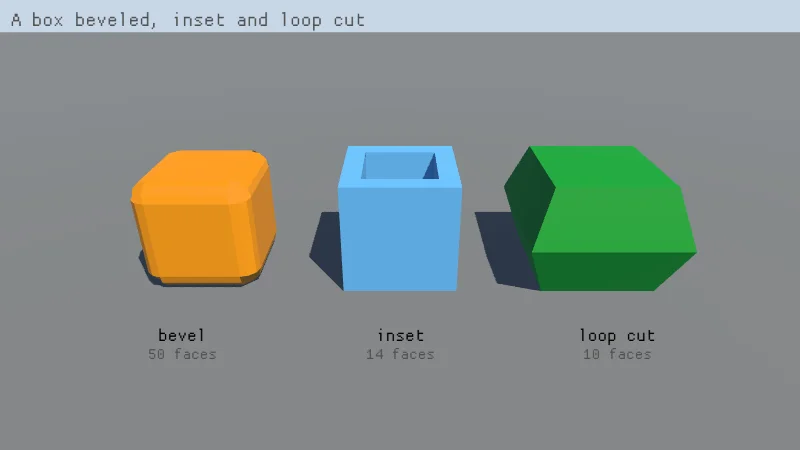
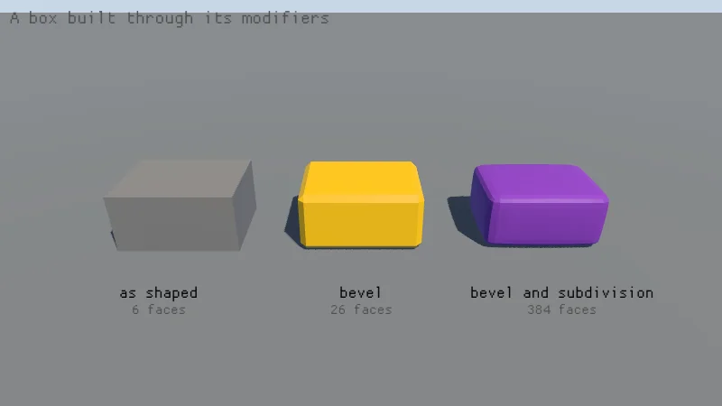
Two examples show an edit mesh's cuts and modifiers, a box beveled, inset and loop cut and a box
rounded through a bevel and a subdivision, and the upgrading page names their calls. (`8d1ec295`)

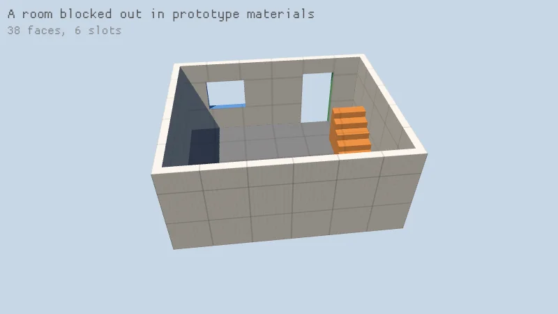
The models_edit_mesh_room example blocks out a room with a window, a door and a stair in prototype
materials, and the upgrading page names the booleans, the openings, glTF and the prototypes.
(`1093ae32`)

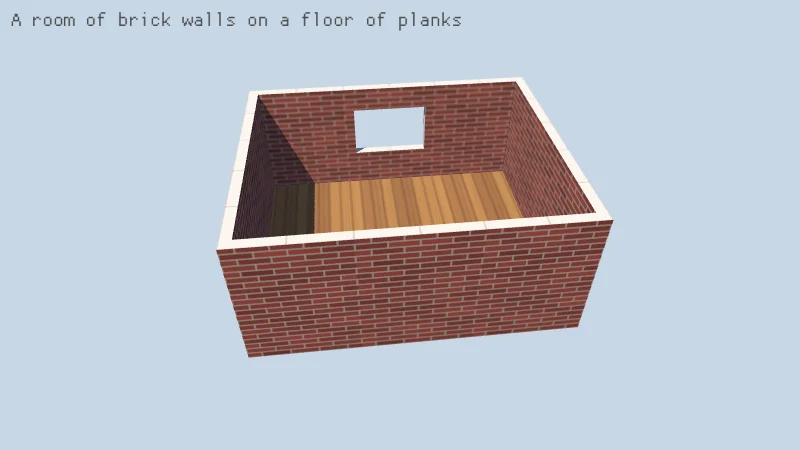
The models_edit_mesh_looks example gives a room's slots looks of brick walls and a floor of planks,
both pictures drawn with the image calls, shown at 256 of their pixels a meter. (`80e83eb6`)

Done that day

- Item 59 at `ffb15cb6`. An edit mesh a program shapes by operations, with a recipe that rebuilds
  it, built into what the engine draws and collides with (Decision 51).
- Item 60 at `1093ae32`. Grid prototyping, materials that show a meter, texture coordinates aligned
  to the world, and openings cut by booleans (Decision 51).
- Item 61 at `5f1e0f6e`. The modeling commands, so a level is blocked out from the terminal, and a
  window in the game to shape by hand (Decision 51).
- Item 62 at `80e83eb6`. Texture coordinates shaped and textures given to faces (Decision 51).
- Item 64 at `8d1ec295`. Modeling operations on faces and edges, Blender's kinds (Decision 51).
- Item 65 at `8d1ec295`. Modifiers, a stack applied at the build and never baked until asked
  (Decision 51).
- Item 66 at `32ad500d`. What is modeled is exported for Blender and imported from it (Decision 51).
- Item 76 at `b48762bb`. A command reads a rectangle of the last frame, its mean color and its
  largest step, so a drive asserts a picture without downloading it (Decision 57).
- Item 78 at `511e0fed`. F1 hides the interface, F3 shows a debug overlay like the newest
  Minecraft's with sections a program adds, and Shift+F3 the profiler with it (Decision 58).
- Item 81 at `c6bb1f3e`. The sky's light set apart from the drawn sky.
- Item 82 at `3bdf68be`. A light sample a program takes with a normal of its own keeps that normal
  (Decision 60).
- Item 83 at `d980d237`. The sun's cascades hold a long shadow across their seams at a low sun
  (Decision 60).
- Item 84 at `21c1b31f`. The README's animated capture of Ore goes.
- Item 85 at `a400a723`. The upgrading page's tests for names gained and lost go, and the page keeps
  changed behavior alone (Decision 64).
- Item 86 at `e8d52f80`. The cheat sheet's lines are one-liners, as BevyCSharp's are (Decision 65).
- Item 87 at `185a79a8`. A headless app's draw list is cleared each frame.

## 2026-10-21

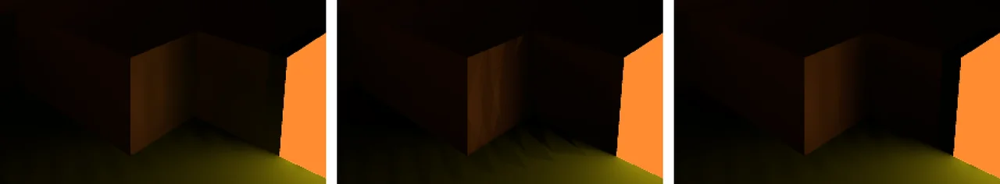
Ore's glowstone light in three crops, read for the glow lights of small emitters (item 71's first
part).

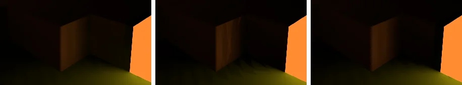
With the screen's probes left out and a glow light lit, probes stand for the glow lights alone,
marching to them once a tile and tracing nothing else, so a pixel reads their light at a cost the
lights do not change, Ore at night with sixty-four lit drawing in 2.50 ms where 9.67. (`0a4928d3`)

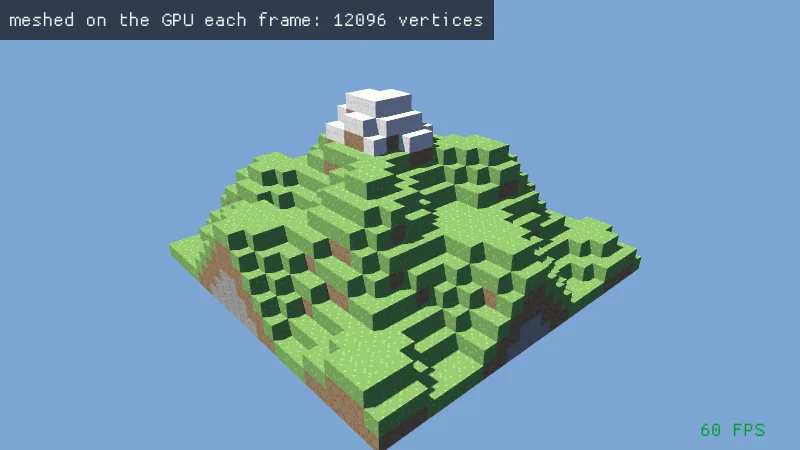
A mesh is drawn from shader buffers a compute shader wrote through LoadMeshFromShaderBuffers, its
vertex count turned into an indirect draw's arguments by one dispatch over the frame's draws ahead
of the frame, culled by the box SetMeshBoundingBox gives it, with the shaders_compute_mesh example
meshing a hill on the GPU each frame. (`50b3aa6f`)

Done that day

- Item 57 at `c2b8c0e9`. A feature-test program puts every feature on one map, a capsule character
  on test courses, an admin panel and a console, with a crash log beside the executable.
- Item 58 at `f78b8c58`. A sound placed by its position is heard from its side and fainter with
  distance, as the audio guide says.
- Item 67 at `b47d20d6`. The first gamepad moves through ImGui only when the program asks.
- Item 68 at `dc487681`. A shader buffer is read back without holding the program.
- Item 69 at `50b3aa6f`. A mesh drawn from buffers a compute shader wrote, with a count the shader
  writes.
- Item 70 at `31444e1e`. An animated capture of a run, frames taken at an interval and written as
  one file, and one made from captures on disk (Decision 53).
- Item 71 at `0a4928d3`. A program leaves the screen probes out of its global illumination, and the
  radiance cascades' faults seen in the voxel game are read and mended (Decision 54).
- Item 73 at `eba9c35a`. F2 takes a screenshot in every program, to a screenshots folder beside it
  (Decision 56).
- Item 79 at `3e83c817`. A masked surface drawn through a program's own shader is cut out of the
  shadow maps by its texture.
- Item 80 at `d3473746`. A tonemap curve a program sets by its numbers, or a tonemap through a
  program's own shader.

## 2026-10-20

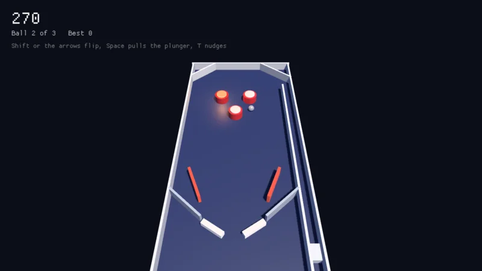
Pinball joins the games, a table of bumpers, slingshots and two flippers whose ball is a continuous
body, its flippers on hinges driven by their motors and its plunger on a slider driven by its own,
played, soaked, resized and captured with the others. (`2271cdea`)

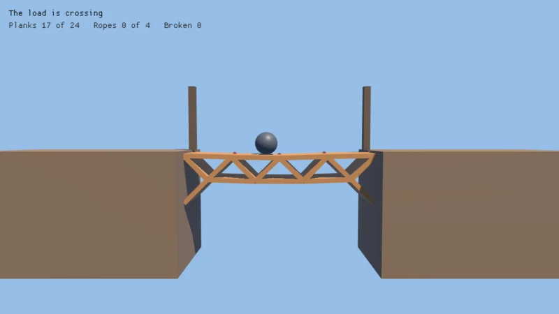
Span joins the games, a bridge of planks on hinges and ropes built over a gap for a load to roll
across, whose joints break past 7,000 newtons read through GetPhysicsJointForce, played, soaked,
resized and captured with the others. (`f74e087f`)

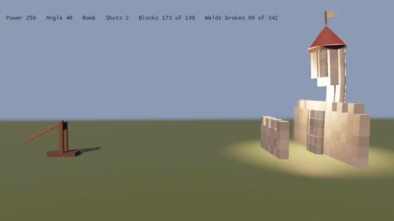
Siege joins the games, a castle of welded boxes and convex hulls thrown at by a catapult on a hinge
driven by its motor until its banner falls, its welds broken past a force and its bombs pushing what
is near them, played, soaked, resized and captured with the others. (`f3949ba6`)

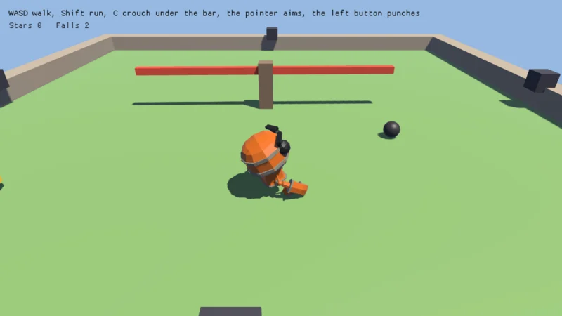
Tumble joins the games, a robot walked by blending its clips and aimed on a layer of its upper body,
crouching by the character's height, which falls as a ragdoll of capsules on ball joints in cones
and hinges when struck and stands up by a blend from the pose it lies in, played, soaked, resized
and captured with the others. (`39103995`)

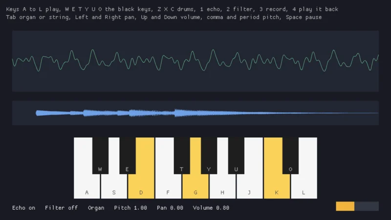
Tones joins the games, an instrument whose samples it pushes through an audio stream with its pitch,
pan, volume and pause, an echo and a filter as the stream's processors and a meter over the mixed
samples, drums read from waves and recordings saved as waves and read back, played, soaked, resized
and captured with the others. (`fd484ead`)

Done that day

- Item 7 at `fd484ead`. A game is written meanwhile.
- Item 30 at `b35bcb8f`. The radiance cascades look as good as they can (Decision 44), the week's
  work, one part a commit.
- Item 35 at `9fd38dd9`. The README's centered parts are markdown inside one centering block
  (Decision 45), and nuget.org draws them.
- Item 36 at `089761fb`. A draw through a program's own shader is culled by its mesh's box where the
  program says the vertex stage keeps the positions (ASKS.md, Voxel-Sandbox's fourth entry).
- Item 39 at `82dd08f2`. RENDERING.md names the terms of the global illumination's method that stand
  unmended, with their figures.
- Item 40 at `d03d0e53`. A program reads a joint's force, `GetPhysicsJointForce`.
- Item 41 at `df03842b`. The contact impulse read is scaled as the joint's force is, so both are the
  force over the step at any substep count.
- Item 42 at `b4b798d4`. A convex hull and a static model are shaped from the mesh and the scale
  alone, the model's transform left out.
- Item 43 at `006ff3ba`. A program reads the audio device's sample rate and channels, so a mixed
  processor knows the samples it gets.
- Item 44 at `4789ebde`. Latin text is kerned and its standard ligatures made, in drawing and in
  measuring alike.
- Item 45 at `00c820ce`. A renamed or reshaped type still reads its old scene files, from
  BevyCSharp's former names and data versions.
- Item 46 at `748779fc`. A run that shows no window makes no sound, its audio going to a device of
  silence while every sound runs.
- Item 47 at `b371b65c`. The cheat sheet is written by a tool from each call's documentation, so the
  two cannot differ.
- Item 48 at `6a289059`. The suite runs once with the schedule's order shuffled by a seed, so a test
  that leaned on an order nothing asked for is found.
- Item 49 at `ec39331c`. An observer is told when a component is added to or removed from an entity,
  or when an event of the game's own is sent to it.
- Item 50 at `e510f268`. A game observes what a pointer does to an entity as events on that entity,
  climbing its parents until stopped.
- Item 51 at `414e6f77`. An animation state machine as a data asset, states each a clip and how it
  plays, transitions tried in order on a parameter.
- Item 52 at `43ace92a`. A message after a load, so a game builds once what a file does not hold.
- Item 53 at `8e31620c`. A saved game laid over the scenes it started from, and a setting read over
  its default.
- Item 54 at `02d89f18`. An order among the systems of one stage, one before or after another or a
  chain, kept under the shuffle.
- Item 55 at `ac77ef83`. A character flies at its move with gravity held off, what it meets still
  stopping it, and a dynamic body is put at a point at rest by one call.
- Item 56 at `b1265b6a`. Data in files of its own, referred to by an id that survives a rename.

## 2026-10-19

Done that day

- Item 34 at `c6914ab3`. An ImGui draw command binds the texture it names, so a window draws a
  program's `Texture2D` (ASKS.md, 2026-10-18).
- Item 37 at `c9e1a5ac`. A package's release notes are the commits since the package last published
  (Decision 47).
- Item 38 at `4af3cdde`. The pack run publishes through nuget.org's trusted publishing and no stored
  key (Decision 48).

## 2026-10-18

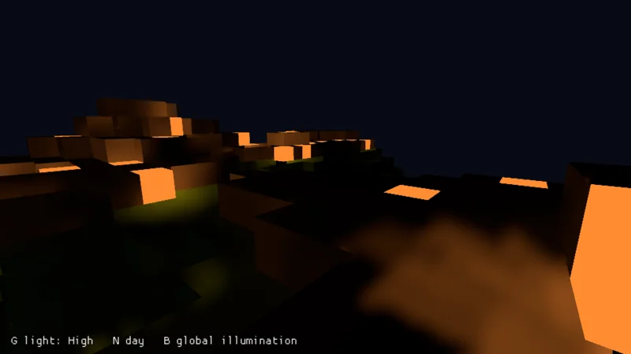
Ore joins the games, a voxel landscape of 48 by 48 columns under global illumination whose emissive
ore is its only light at night, walked in the first person, and played, soaked, resized and captured
with the others. (`4c6630a4`)

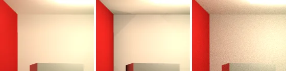

The light global illumination gives is read against path-traced references in the examples that draw
it and in Ore, with six faults pictured, measured and placed in the cascades. (`4fa51a9c`)

A particle emitter may keep its particles in its entity's space, turning with it and its parent, and
hold particles the program places at points there, which an example of a turning sky shows.
(`f5035acd`)

Done that day

- Item 26 at `4d5db9df`. Two workflows an engine, `build.yml` on a push and `pack.yml` by hand
  (Decision 40), committed at `534a1c2b`, done on 2026-10-18 with the pack run of `4d5db9df` whole
  green after the push run of `683e6e9d`.
- Item 27 at `b40a788d`. The voxel game leaves for its own repository (Decision 41).
- Item 28 at `4c6630a4`. A tiny sample, `games/Ore`, a voxel landscape, a character and the light
  that bounces.
- Item 31 at `29eb2eca`. An example shows raylib's picture and none of the engine's making, the
  gamepad's controller first (Decision 44).
- Item 32 at `f5035acd`. Particles that live in their emitter's space and stand where the program
  puts them, for the game's stars (ASKS.md, 2026-10-18).
- Item 33 at `a2df7bb4`. A setting turns the sun's contact shadows off, or leaves them out where the
  shadow map holds the point (ASKS.md, 2026-10-18).

## 2026-10-17

The Cornell box before and after the light that bounces, and the bounce rooms after it, at the
radiance cascades' first landing.

Done that day

- Item 29 at `7b2486a5`. The register, STYLE.md's rule and the sweep (Decision 43).

## 2026-10-12

Done that day

- Item 2 at `c54d64eb`. Four things seen in the voxel game on 2026-10-10 (Decision 27), before item
  3's remainder.
- Item 3 at `42b3e9ce`. Subsurface scattering, the first of Decision 16's spectral experiments
  (Decision 18), in three batches, each measured, what of its first batch stands alone committed
  before item 2 begins.
- Item 4 at `82b23f8c`. The animated model's meshes in the world (Decision 21), after subsurface
  scattering.
- Item 8 at `c81eca54`. An opaque material's hidden fragments are rejected before they are lit;
  measured, the hidden land costs geometry, not fragments.
- Item 9 at `feec07a2`. A color stream written in place reaches the bounce.
- Item 10 at `c54d64eb`. A post-processing window in the overlay, which a game opens as it opens its
  performance window (Decision 28).
- Item 15 at `35322cfe`. `Engine3D` becomes `E3D` (Decision 32).
- Item 17 at `2172090b`. The radiance cascades said in the README and in a guide page of their own
  (Decision 33).
- Item 21 at `86fba7ad`. The colors of a mesh of positions alone serve the light field alone and
  reach no buffer.
- Item 22 at `e424550c`. The wall before the pillar blends in probes standing at the pillar's dark
  face; the screen's probes reach the pillar themselves.
- Item 23 at `6a36b2b5`. A mesh casts the sun's shadow and stays out of the light field, and a
  moving mesh's stamp costs less.
- Item 24 at `2a14ab13`. The glow lights' shadow past a box's edge is a step where a penumbra
  belongs.
- Item 25 at `9a3e2e2a`. The macOS captures move to the pack run (Decision 38).

## 2026-10-11

A pixel reads the glow lights its probes mark alone, an eighth of their light or more, with the
probes weighed once, and the march ends inside a wall by its own condition, so the model pass's
share in a room of sixteen lamps falls from 0.47 ms to 0.25. (`0f5cdbcf`)

Keeps a closed cave from taking the sky's light by ending every cascade's band short of the eye and
reading the bounce's hold at the surface where that holds more, passes over probes whose rays meet
more faces from behind than in front, holds the bounce while the last cascade is unbuilt, and drops
a young glow blend where the field was built again under it. (`64fd2f14`)

Lights the floor under a block floating below a row of joined lamps by halving a level face along
its longer side where neither side rises from the surface, and by stepping out of a surface across
the march as well as along the surface's normal. (`56db892b`)

Lets a mesh carry a vertex stream of the program's own, read as CUSTOM0 and written in place, and
makes the pack wait on the examples job. (`958a3eb3`)

Done that day

- Item 5 at `1fa88e8b`. The first shares recorded from the workflow's own device.
- Item 11 at `e28064f7`. The README's examples as one scrolling row a folder, the games' text under
  them gone.
- Item 12 at `7a69c936`. The e3d skill left the `.claude` folder.
- Item 13 at `ffa3ec48`. `games/Pusher` is gone.
- Item 14 at `e910f4f4`. The development machine's GPU is named nowhere a user reads (Decision 32).
- Item 16 at `ffa3ec48`. The README's guide table opens with the cheat sheet's row.
- Item 18 at `043b3af1`. The examples' counts under the Examples heading, and a count on each
  folder's heading (Decision 34).
- Item 19 at `7798d5e5`. A push plays one game, and the pack run plays them all (Decision 35).
- Item 20 at `958a3eb3`. A vertex stream of the game's own beside the mesh's vertex, and a vertex of
  positions alone (Decisions 36 and 37).

## 2026-10-10

Subsurface scattering's first experiment, the spheres with the light under the surface on and off
(item 3).

The light that bounces is measured against references of one, two and every bounce and at its
probes, which places most of its loss in a pi missing from the light a ray's hit sends on, with four
artifacts pictured and measured. (`0499c115`)

The light under a surface is spread at the quality SetSubsurfaceQuality sets, a new example shows
it, and the light that comes through a thin part is measured without the bands, scallops and stripes
drawing it found. (`94c4bf3b`)

A material's own thickness, which a glTF file's KHR_materials_volume sets, caps the thickness the
light from behind is measured to cross, and a spot or point light that casts shadows measures it
from its own map where the scene's field is coarse. (`63961dbb`)

The drive script says where a command finds no session whether the game's process still runs and,
ended, its exit code and the crash Windows logged of it. (`e50fd247`)

## 2026-10-09

The bounce rooms, the test scenes the global illumination is read against, each a view with its
path-traced reference.

A level of the eight rooms the light that bounces finds hardest, each with a fixed view, and a
script that measures each view at each quality against its path-traced reference. (`575f5f66`)

## 2026-10-08

A thirteenth game, Wick, is a puzzle in a dark house lit by a lamp the player carries, whose light
reaches round corners and through doorways only as light that bounces. (`11368439`)

## 2026-10-07

An eighth game, a rhythm game whose notes are judged by the time of the music heard, its song a
tracker module and its chart written from the same rows, played through by its autopilot, soaked and
stormed by CI. (`48939b42`)

A ninth game for two players on one screen splits the window between two cameras drawing into render
textures, draws with shaders of its own and paints its floor with a compute shader, and e3d makes
console pads up to the one named so a second player is driven. (`2b5b0873`)

A tenth game played by typing takes its words from a dropped file, falls them along splines, makes
its sounds in a stream's callback and copies its result to the clipboard, and a run with no window
keeps a clipboard of its own. (`01bfcae8`)

An eleventh game, the puzzle of merging tiles, is played by gestures, draws its tiles' faces into
images and makes its sounds as waves, and input.click takes a count so a double tap can be driven.
(`a9ff8c1b`)

A twelfth game, a runner, squashes and stretches by its model's morph targets and records each run
as automation events, watched again to the same end in the session and from a file in a new one.
(`37064205`)

A distance field of the scene around the camera, built on the GPU from the meshes that cast shadows
and stamped with those that move, darkens ambient occlusion beside the screen's, gives the sun soft
contact shadows and lets particles bounce off what the window does not show. (`f2d99b65`)

Light bounces between surfaces through the scene's distance field as hybrid Radiance Cascades, in
three qualities measured for their memory and GPU time, with a Cornell box and Manor's library as
reference frames. (`3e00ac64`)

Glossy surfaces trace their reflections through the window's depth, reading the frame before's
picture, and on through the scene's distance field, falling back to the probes and the environment
as they grow rough. (`80227981`)

## 2026-10-06

Twelve of raylib's models examples are written, shapes_basic_3d takes raylib's name, and the
cubicmap, single-sided materials and the sphere's winding answer as raylib's do. (`dc13ca69`)

Five more of raylib's models examples are written, and a bone named as a mesh, a joint that weighs
nothing and a frame between two answer as raylib's do. (`1e47d1af`)

Six of raylib's audio examples are written from its source, their sounds fetched from raylib's
examples. (`141eb8eb`)

Nine of raylib's shaders examples are written with their GLSL in Slang, and the torus and knot take
raylib's numbers and planes. (`fc8c3f9c`)

Ten more of raylib's shaders examples are written, GetShaderLocation finds array elements and struct
fields by GLSL's names, and models_mesh_generation is raylib's. (`579b2194`)

The rest of raylib's shaders examples and its spectrum visualizer are written, GenImagePerlinNoise,
DrawSphereWires and the far plane are raylib's, pixels written into a render texture keep their
place among its drawing, and ImGui is given the mouse buttons in its own order. (`ef042886`)

The last of raylib's models examples that can be written are, an OBJ's dissolve and a clip's frame
count are raylib's, and the timing example's keyframe marks show over its bar. (`d52d9651`)

rlgl's vertices given one at a time and its matrix stack are carried as raylib's examples call them,
and seven of those examples are written. (`bdf197ce`)

raylib's three text examples that read glyphs by index are written with GetGlyphInfo by code point,
and a font's tab draws as raylib's does. (`5c89a408`)

Carries rlgl's culling and point mode as states of the draw list and the model pass, winds every
shape, texture and text as raylib's rshapes.c does so culling keeps them, and ports
shapes_rlgl_triangle, models_point_rendering and shaders_cel_shading. (`6673c8bd`)

Carries raylib's high density, transparent, unfocused, always-run and borderless window flags, tells
fullscreen from borderless as raylib does, keeps a hidden run's window hidden, and ports
core_highdpi_demo, core_highdpi_testbed and core_window_flags. (`42f3dfea`)

Carries rlgl's custom blend factors and modes into the immediate pass, discards clear texels in 3D
alone as raylib blends them in 2D, and ports shapes_top_down_lights and textures_magnifying_glass.
(`73ab123c`)

Reads BMFont's .fnt files in LoadFont, its pages stacked into one atlas and a gray page drawn white
as raylib does, and ports text_font_loading and text_unicode_emojis. (`c732ac54`)

Carries rlgl's depth test and mask as draw-list states, its matrix modes with a projection of a
program's own, and a shader's written depth, and ports shaders_depth_writing,
shaders_hybrid_rendering and textures_portal_window. (`5e6f1722`)

Carries raylib's PixelFormat with LoadImageRaw, which reads a format into an image's four bytes a
pixel, and ImageFormat, which keeps what a format keeps, and ports textures_raw_data and
textures_image_processing. (`6639650a`)

Carries raylib's audio processors, the mixed ones on SDL3's postmix callback on the audio thread and
a stream's or a piece of music's as it queues its samples, and ports audio_mixed_processor and
audio_stream_effects. (`0ea9401c`)

Carries the monitor's size as raylib's SDL3 backend reckons it, PollInputEvents and SwapScreenBuffer
for raylib's custom frame control, reads GetTime from the clock as raylib does, and ports
core_monitor_detector and core_custom_frame_control. (`5916882f`)

Gives a mesh a color and a second texture coordinate at each vertex in buffers of their own, read
through a second vertex stage only for a mesh that has them, reads MagicaVoxel's files as raylib
does, and ports models_loading_vox. (`cac05ded`)

Carries UpdateMeshBuffer by raylib's index for a mesh's arrays, giving a mesh colors and second
texture coordinates it lacks, and ports shaders_lightmap_rendering. (`6c0b07ca`)

Reads Inter-Quake Models as raylib does, an IQM's skeleton into LoadModel and its clips at the
file's own frames into LoadModelAnimations, has IsModelAnimationValid compare counts and parents
with names where a clip has them, and ports models_loading_iqm. (`52304768`)

Reads Model 3D files as raylib does through m3d.h, a mesh for each run of faces of one material with
raylib's last bone and its actions posed every 17 milliseconds, and ports models_loading_m3d.
(`e5ea2a22`)

Draws a render texture into up to four images of their own formats at once, as a G-buffer is,
carries rlgl's color blend switch, and ports shaders_deferred_rendering. (`692cefee`)

The shaders examples are measured, mesh instancing and postprocessing are raylib's own programs with
the engine's kept under names of their own, the cube lays its texture as raylib's does, and normals
under a scaled node keep to their surface. (`0f26acf3`)

raylib's automation events are carried, recording each frame's input into its text format and
playing it back, and core_automation_events is written. (`3082aad5`)

LoadImageFromScreen reads the last frame presented, kept from its first call on, and
core_screen_recording is written with a GIF writer of its own. (`53d99c7e`)

LoadTextureCubemap makes a cube texture a shader's SamplerCube samples, models honor
rlDisableDepthMask, and models_skybox_rendering is written. (`586670cd`)

Music opens XM and MOD modules, played by a tracker player of the engine's own that follows
raylib's, and audio_module_playing is written. (`56564fe2`)

raylib's VR stereo is carried, the 3D of a BeginMode3D drawn once for each eye into each half as
rlgl draws it, and core_vr_simulator is written with raylib's distortion shader in Slang.
(`1e26d438`)

## 2026-10-05

The gallery's captures are WebP at the size their window is drawn, lossy for a lit 3D scene and
lossless for flat color, which takes the folder from 3.4 MB to 876 KB. (`e673197a`)

Particle emitters, a component and seven flat functions, give off particles a compute shader steps
and the model pass lights, shown by a campfire example and checked by pixels and a reference.
(`8aeb778b`)

A racing game drives a car of one box on four rays as springs round a dirt road through gates that
are triggers, physics gains pushes at a point and a body's turn, and rays go through triggers.
(`b5eb3642`)

Manor walks a house of six rooms and its grounds for six lanterns, its cells streamed in and let go,
its doors on hinges, its menus and settings played with a gamepad alone, and CI plays, soaks and
storms it. (`9c21b066`)

A seventh game, a strategy board seen from above with ray picking, a box selection listed in ImGui,
fog, paths by Dijkstra and A*, a saved match and an opponent, played, soaked and stormed by CI.
(`7a8360ae`)

A first game told from an empty folder in twelve steps, each a whole program the workflow builds and
runs and the page is tested against. (`d5d2578d`)

Twenty-eight of raylib's core examples are written from its source, and what a program draws between
frames, into a render texture before BeginDrawing, is drawn. (`14c8b4a1`)

The flat API carries raylib's rcamera functions, UpdateCamera moves a camera as raylib's does, and
core_3d_camera_first_person and core_3d_camera_fps are raylib's examples written again. (`71224507`)

core_2d_camera_platformer and core_viewport_scaling are raylib's examples written again, and the
comparison with raylib names the default filter and samples that differ from its. (`a77f6e5c`)

core_input_gestures_testbed and core_input_virtual_controls are raylib's examples written again.
(`4be25c8e`)

Nine of raylib's shapes examples are written again, shapes_basic_2d among them under raylib's name
shapes_basic_shapes, and DrawCircleGradient takes its center as raylib's does. (`d17fb83d`)

Nine more of raylib's shapes examples are written again, with raylib's easing functions and two of
its raymath functions beside them for the examples that call them. (`71dcbdeb`)

Eleven more of raylib's shapes examples are written again, among them the clock of clocks, the ball
physics and the Penrose tiling. (`817e4cea`)

Seven of raylib's shapes examples that use raygui are written with ImGui's controls where raygui's
stand, in ImGui's light style. (`5ba111bd`)

The last eight of raylib's examples that use raygui are written with ImGui in its place, and default
text below ten pixels and the frame rate's color answer as raylib's do. (`590b9ac3`)

Nine of raylib's text examples are written, and a missing glyph, repeated code points and texture
filters answer as raylib's do. (`4c7b3f06`)

The 25 of raylib's textures examples the flat API can carry are written, and a texture loaded since
the last frame reads back at once as raylib's does. (`7ba078c8`)
